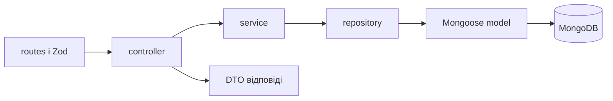

# Архітектура навчального backend

Чинне рішення від 12 жовтня 2026 року: модульний моноліт із плоскими папками модулів, service, repository та ручним DI через конструктори. Попередню структуру Onion із domain/application/infrastructure/presentation скасовано. Бізнес-вимоги визначені в [00_Consolidated_Requirements.md](../requirements/00_Consolidated_Requirements.md).

## Чому така структура

Команда вивчає Node.js. Кожна відповідальність має зрозумілий файл; не створюємо клас для кожної операції, універсальні базові репозиторії або контейнер DI. Залежності передаємо явно, зберігаючи можливість окремих тестів.

```text
src/
├── app.js                     Express і порядок middleware
├── server.js                  з’єднання БД, HTTP, завершення
├── config/                    перевірені параметри та підключення
├── middleware/                захист, валідація, помилки, tracing, Swagger
├── openapi/                   генерація контракту, спільні відповіді та розширений Zod
├── utils/                     спільні помилки, HTTP-константи й сервер
├── telemetry/                 SDK, контекст і dev-дані
└── modules/
    ├── index.js               реєстрація модулів і складання repository
    └── groups/
        ├── group.routes.js
        ├── group.controller.js
        ├── group.service.js
        ├── group.repository.js
        ├── group.model.js
        ├── group.schema.js
        ├── group.openapi.js
        ├── group.dto.js
        ├── group.constants.js
        └── group.module.js
```

## Де писати код

| Файл | Відповідальність | Чого тут не пишемо |
|---|---|---|
| routes | Адреси та порядок middleware | Бізнес-правила, MongoDB-запити |
| controller | HTTP-вхід, виклик service, статус і DTO | Розрахунки й доступ до моделі |
| schema | Zod-контракти входу та публічних відповідей, невідомі поля | Запити до БД |
| openapi | Опис HTTP-операцій із готовими Zod-схемами | Бізнес-правила та власні копії обмежень полів |
| service | Бізнес-правила, права, послідовність операцій | Express, Mongoose-запити |
| repository | CRUD, aggregation, перетворення ObjectId | HTTP-відповіді, бізнес-рішення |
| model | Схема документа Mongoose | Оркестрація сценаріїв |
| dto | Явний набір публічних полів | Запити до БД |
| constants | Стани, межі, коди | Виконання операцій |
| module | Складання DI | Бізнес-розрахунки |

Не всі майбутні модулі потребують кожного файла. Новий файл створюємо, коли є реальна відповідальність. Великі чисті формули можна винести з service у `<module>.calculations.js`; великі pipeline — у `<module>.queries.js`.

## Шлях запиту та DI



Це порядок виконання. Залежності збираються окремо:

```text
server.js створює apiRouter через modules/index.js
modules/index.js створює repository та передає його GroupModule
app.js отримує тільки готовий apiRouter
module створює service з repository
module створює controller з service
module створює routes з controller
```

Service не імпортує repository або model. Репозиторій отримує groupModel через конструктор. Для HTTP-тесту передаємо тестовий repository у createApiRouter, а готовий router — у createApp. Окремої бібліотеки DI немає.

## Класи та this

За рішенням користувача GroupService, GroupRepository, GroupController і GroupModule реалізовані класами. Залежності передаємо як об’єкт аргументів constructor і зберігаємо в this. Module створює service та controller через new; modules/index.js створює repository й передає його модулю. app.js не імпортує бізнес-модулі.

```javascript
const repository = new GroupRepository({ groupModel: GroupModel });
const groupModule = new GroupModule({ groupRepository: repository });
router.use('/groups', groupModule.router);
```

Методи controller передаються Express через bind(groupController), щоб callback зберіг доступ до this.groupService. Методи service/repository викликаються через їхні об’єкти. Телеметрія не обгортає бізнес-об’єкти; працює тільки спільний HTTP middleware.

Routes, DTO, чисті правила, seed і технічні helpers залишаються функціями там, де немає стану об’єкта. Не вводимо спадкування або базові класи заради самого стилю. Один service містить методи модуля; окремого класу для кожної операції немає.

## Валідація та DTO

Zod перевіряє формат HTTP-входу; service перевіряє бізнес-правила незалежно від HTTP; Mongoose перевіряє документ при записі через модель. Межі беруться з constants. Mongoose не перевіряє ручний запис через PhpStorm або mongosh.

Repository повертає звичайні об’єкти зі строковим id. DTO окремо визначає поля, які можна віддавати клієнту. _id, __v та Mongoose-документи не виходять у API. Під час появи авторизації DTO враховуватиме політики доступу до полів.

## Захист і життєвий цикл

app.js підключає requestId/логи, tracing, Helmet, загальний rate limit, ліміт запису, JSON-парсер з лімітом, маршрути та errorHandler. Rate limit стоїть перед парсером. Trust proxy вимкнений для прямого локального запуску.

config/security.js перевіряє параметри; middleware/security.js створює окремі лічильники для кожного застосунку. utils/createHttpServer.js встановлює HTTP-тайм-аути.

server.js перевіряє порт і конфігурацію, чекає MongoDB, створює API та відкриває порт. При SIGINT/SIGTERM завершує HTTP, експорт tracing і з’єднання MongoDB; є загальний ліміт завершення. При недоступній MongoDB запуск завершується помилкою; автоматичного переходу на пам’ять немає.

## MongoDB та Aggregation Framework

Звичайний запуск працює з MongoDB. Репозиторій groups реалізує findAll, findById, insert і summarizeByAge. Некоректний чи відсутній ID перетворюється на GROUP_NOT_FOUND із HTTP 404.

GET /api/v1/groups/summary виконує справжній aggregation: $group → $project → $sort. Повертає ageCategory, groupsCount, totalCapacity. Місткість не є кількістю зарахованих дітей. Це перший навчальний звіт; майбутні фінансові звіти також виконуватимуться на MongoDB Aggregation Framework.

## Майбутні міжмодульні операції

Модуль змінює власні дані; інший модуль викликає через його service. Спільні workflows за потреби лежатимуть у src/workflows, без циклічних імпортів services.

Правила транзакцій, конкурентного зарахування, унікальних індексів, фінансових знімків та аудиту залишаються обов’язковими за зведеними вимогами. UnitOfWork відкриває одну MongoDB session для callback, передає її адаптерам разом із вузьким записом audit_logs і запускає зовнішні дії лише після успішного commit. Callback містить тільки транзакційні операції: MongoDB може виконати його повторно.

```js
await unitOfWork.execute(async ({ session, recordAudit, afterCommit }) => {
  await groupModel.updateOne({ _id: groupId }, update, { session });
  await recordAudit({
    actorId,
    requestId,
    action: "GROUP_UPDATED",
    entityType: "GROUP",
    entityId: groupId,
    safeFields: ["name", "status"],
    before,
    after,
  });
  afterCommit(() => publishGroupUpdate(groupId));
});
```

Аудит зберігає лише явно вибрані прості поля; імена чутливих полів відхиляються, вкладені об’єкти не приймаються. Помилка запису аудиту відкочує бізнес-зміну. Транзакційний callback не повинен виконувати зовнішні ефекти безпосередньо.

Middleware майбутньої автентифікації визначатиме користувача; service перевірятиме право на дію та конкретний запис. JWT, ролі й політики ще не реалізовані.

## Перевірки та робота команди

npm run check перевіряє форматування, синтаксис і тести HTTP, service, захисту та телеметрії без Docker. Сховище в пам’яті лежить тільки в tests/helpers. npm run test:mongodb окремо перевіряє CRUD, DTO, aggregation і збереження після повторного підключення на MongoDB; використовує власну випадкову базу.

Перед новим кодом визначаємо його відповідальність, вхід і вихід. Завершуємо одну операцію цілком, оновлюємо OpenAPI та документацію. Мову коментарів і документації зберігаємо українською.

Запуск Windows/macOS — [06_Local_Startup.md](../development/06_Local_Startup.md). Tracing — [05_Local_Telemetry.md](../development/05_Local_Telemetry.md).

## Реєстрація модулів та межі app.js

src/modules/index.js — єдине місце реєстрації бізнес-модулів. Тут створюємо конкретні repositories та modules. Для нового модуля додаємо його залежності й router.use у цьому файлі; app.js не змінюємо.

createApp отримує готовий apiRouter та securityConfig. Він налаштовує Express, requestContext, HTTP-захист, tracing, службові маршрути та errorHandler. З’єднання MongoDB і запуск HTTP — відповідальність server.js. Параметри HOST/PORT перевіряє config/server.js до підключення БД.

GET /api/v1 повертає name, version із package.json, documentation та openapi. Список бізнес-маршрутів не дублюється в цьому endpoint: його джерело — OpenAPI. HTTP-формат операцій groups збережено.

## Генерація OpenAPI

OpenAPI генерується під час створення застосунку з Zod-схем та описів операцій модулів. Додавання router і реєстрація його документації — явні окремі дії; генератор не сканує Express. Схеми відповідей описують DTO, а не Mongoose-документи; їх відповідність перевіряють тести. JSON у docs — експорт, а не джерело для сервера. Покрокова інструкція — [11_OpenAPI_Generation.md](../development/11_OpenAPI_Generation.md).

## Єдиний стиль коду

Prettier — dev-залежність, не частина роботи API. Налаштування в .prettierrc.json: 2 пробіли, одинарні лапки, крапки з комою, ширина рядка 100. npm run format форматує JS у src/scripts/tests, npm run format:check тільки перевіряє. Загальний npm run check також перевіряє формат.
