https://kindergarten-entity-map.jollysky65.chatgpt.site

# Карта сутностей і залежностей дитячого садка

Версія 1.0 · 11 жовтня 2026 року · Цільова модель першої завершеної версії.

Ця карта пояснює, з яких частин складається система, де зберігаються дані та як бізнес-операції поєднують їх. Основне джерело правил — [узгоджені вимоги](../requirements/00_Consolidated_Requirements.md). Діаграми описують результат, який будуємо; у поточному backend 0.3.0 реалізовано лише початковий модуль груп та HTTP-захист.

## Як читати діаграми

Не плутати три різні зв’язки:

| Зв’язок | Значення | Приклад |
|---|---|---|
| Посилання | Один документ містить ідентифікатор іншого | Дитина → група через groupId |
| Вкладені дані | Об’єкт або обмежений масив усередині документа | Людина → employee |
| Знімок | Копія умов, зафіксована на дату операції | Рахунок → застосований тариф і відсоток пільги |
| Залежність виконання | Сценарій викликає порт іншого модуля | Зарахування → reserveSeat |
| Похідний результат | Значення розраховане з інших записів | Фінансовий звіт → рахунки, платежі та витрати |

У flowchart стрілка «посилається» спрямована від документа, який зберігає ID, до документа, на який він посилається. Пунктир використовуємо для вкладення, знімків або читання; значення написане на ребрі. У діаграмі ER символи біля вузлів показують кількість: `||` — один, `o|` — нуль або один, `o{` — нуль або багато. Напрямок ER не є напрямком виклику коду.

Технічні назви англійською є орієнтирами для реалізації. Вкладені об’єкти на схемах не створюють окремі MongoDB-колекції. Форма портів і DTO деталізується в завданні відповідного модуля.

## 1. Загальна бізнес-карта

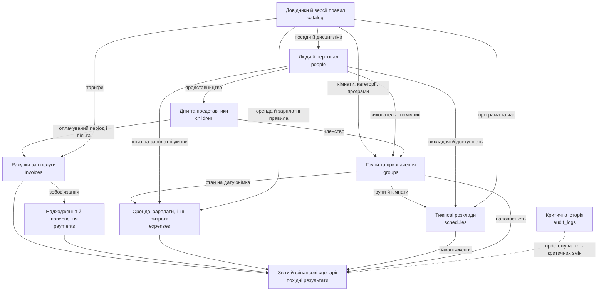

На цій схемі стрілки означають бізнес-вплив, а не прямі імпорти між файлами. Аудит використовується для пояснення змін; звичайні фінансові звіти не відновлюють минулий стан із журналу аудиту.

## 2. Фізична модель: дев’ять колекцій

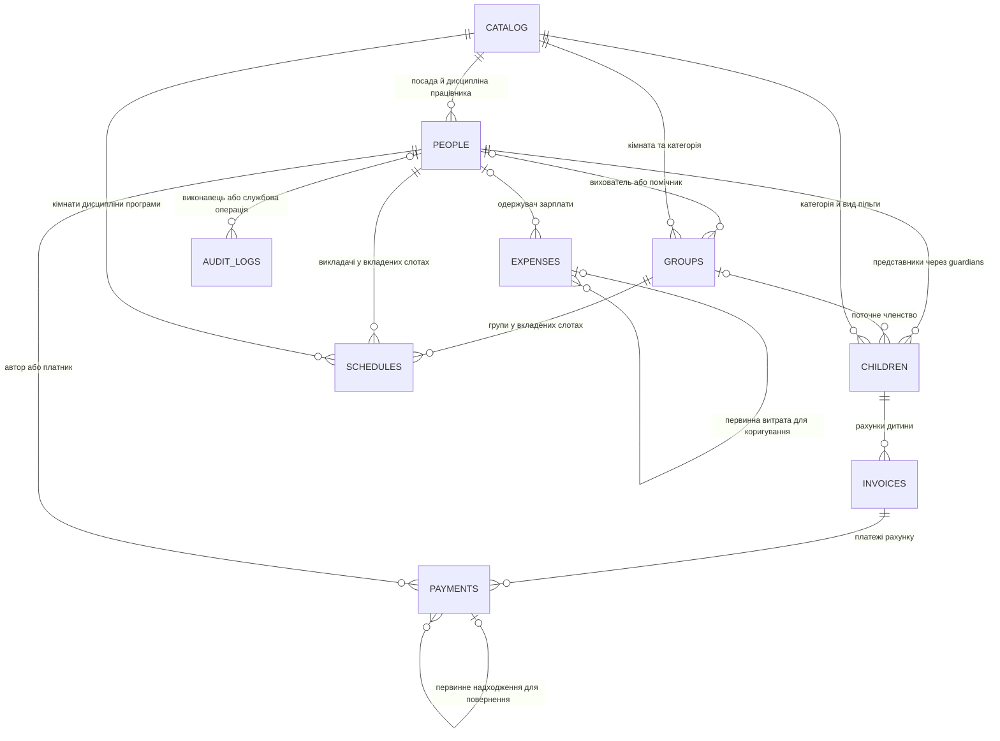

ER показує агреговані зв’язки через вкладені масиви: один розклад може містити багато груп і викладачів, а одна дитина — до 4 представників. Це не дев’ять SQL-таблиць із зовнішніми ключами: існування та вид посилань перевіряє Application, унікальність — індекси MongoDB.

Вихователь, помічник і кімната можуть історично зустрічатися в багатьох групах, але **одночасно мають тільки одну активну групу**. Одержувач є не в кожної витрати: оренда не посилається на працівника. Аудит указує ціль через entityType/entityId; одна універсальна стрілка до всіх колекцій не є окремим зовнішнім ключем.

## 3. Людина, account, посада та роль

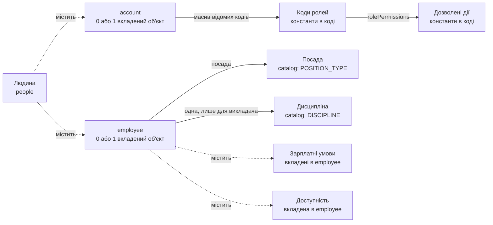

**Посада визначає роботу й зарплату; роль визначає право в API.** Представник — це зв’язок людини з дитиною. Людину не дублюємо для кожної ролі. Блокування account не звільняє працівника, а роль EDUCATOR не призначає його групі.

## 4. Дитина та її оточення

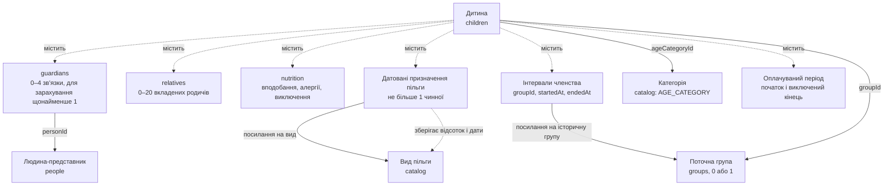

У схемі «поточна група» та «історична група» означають документи тієї самої колекції groups; ID історичного інтервалу не обов’язково дорівнює поточному. Знімок відсотка пільги не оновлюється автоматично зі зміною довідника. Родичі не отримують доступу через сам факт запису в relatives.

Поточні ACTIVE та SUSPENDED займають місце; APPLICANT та LEFT — ні. Переведення не змінює початок оплати. Харчові дані не визначають суму рахунку: тариф залежить від вікової категорії, а не від алергій.

## 5. Група та обмежені ресурси

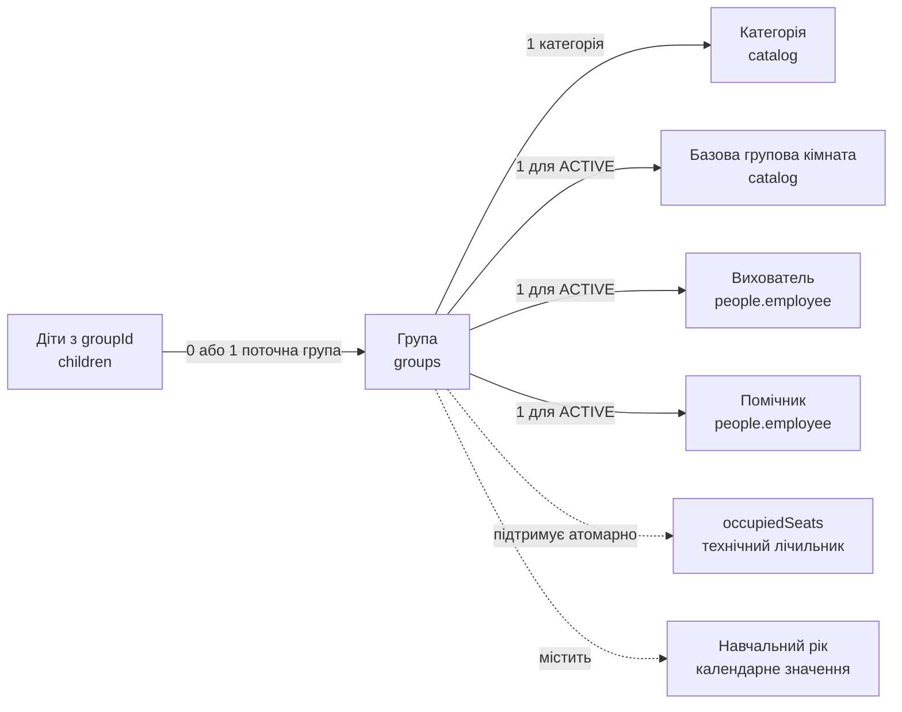

Для DRAFT призначення можуть бути неповними. Для ACTIVE обов’язкові всі три ресурси. Місткість до 20 і не більше місткості кімнати. Список дітей є запитом, не вкладеним масивом групи. Навчальний рік — не окрема колекція.

При деактивації потрібна відсутність зайнятих місць та перевірка майбутніх опублікованих тижнів. Порожня активна група має базову зарплату вихователя й помічника.

## 6. Catalog: види записів і версії

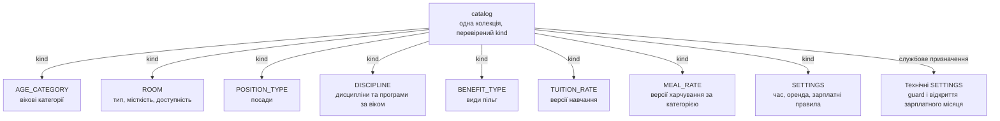

Це види документів, не вкладені масиви одного величезного catalog-документа. Тариф і фінансове правило версіонуються через effectiveFrom. Guard — змінюваний технічний запис; до нього не застосовуємо незмінність тарифу. Початкові коди видів, ролей і дозволів не створюються користувачем довільно.

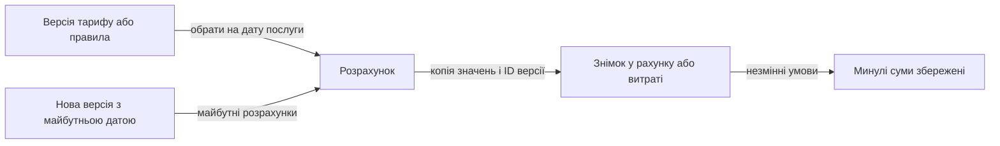

## 7. Розклад і програма

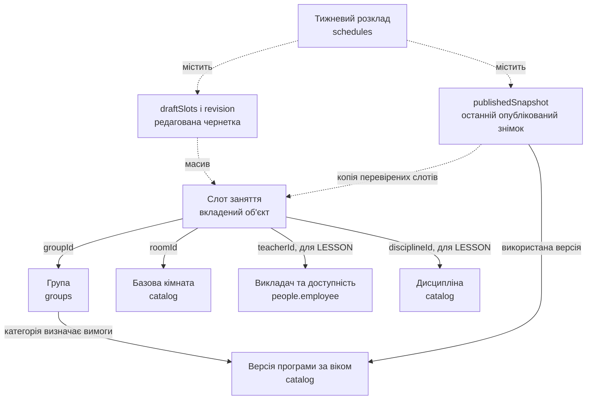

Slot — не окрема колекція; вузол представляє структуру слотів двох різних масивів. Сон і прийоми їжі мають групу, кімнату й інтервал, але не потребують викладача дисципліни. Для заняття всі ресурси перевіряються разом. Вихователь і помічник також повинні бути доступними для роботи групи.

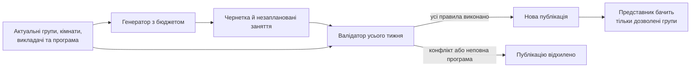

Нова чернетка не приховує попередню публікацію. Зміни ресурсів і публікація використовують спільний RESOURCE_GUARD. Несумісне призначення допускається тільки через узгоджену атомарну заміну ресурсів і потрібних публікацій. Невдача генератора не доводить неможливість розкладу.

## 8. Рахунок, платіж, пільга та харчування

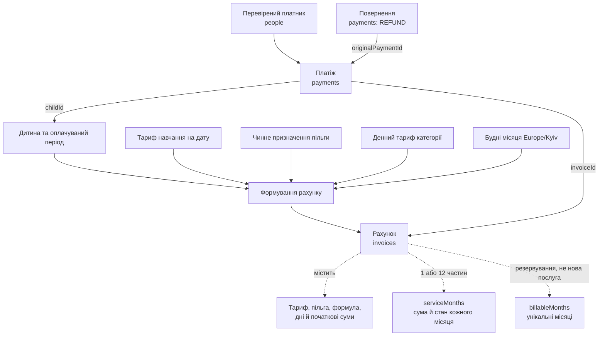

Місячне навчання отримує персональну пільгу. Річне навчання — персональну пільгу, потім 12% річної знижки. Харчування не отримує жодної з цих знижок. Річний рахунок має 12 місячних частин, харчування — окремі місячні рахунки.

Сума платежу не є доходом місяця послуг: оплачений рік дає надходження одразу, а дохід — за частинами. PENDING і REJECTED не входять у надходження. Прострочений неоплачений рік потребує явного переходу на місячну оплату.

## 9. Фінансові потоки

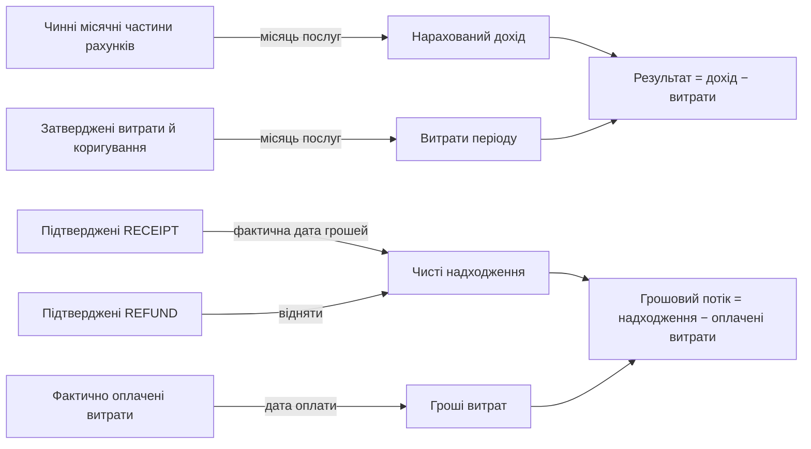

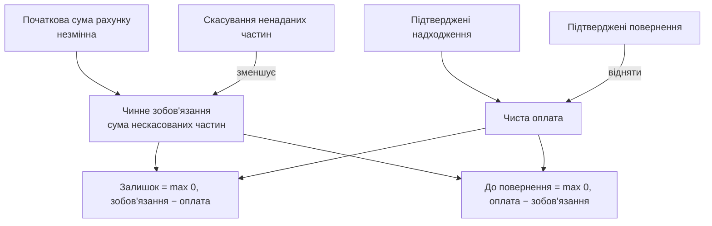

Повернення після скасування не створює боргу за скасовану послугу. Current outstanding і refund due — окремі поточні показники з asOf; історичний борг на кінець минулого місяця не реалізуємо.

## 10. Зарплата та витрати

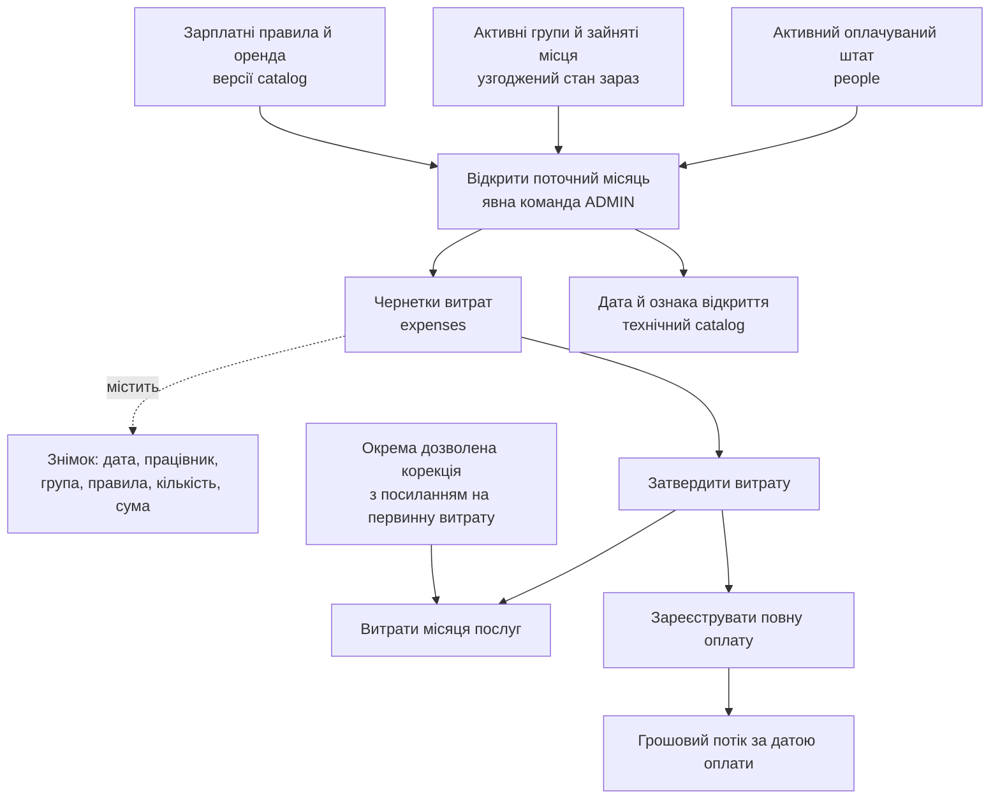

Дата знімка — фактична дата першого відкриття, не вигадане перше число. Повтор відкриття не перераховує суми після переведення дітей чи заміни працівника. Нарахування зарплати не є оплатою зарплати. Посада й призначення є входом розрахунку; роль ADMIN/PARENT — ні.

Наявність алергії або тарифу харчування не змінює зарплатну формулу. Оренда одна на будинок. Expense зі зарплатою посилається на працівника, оренда — на застосоване правило. Усі автоматичні витрати мають унікальний sourceKey. Історичний пропущений місяць оформлюється вручну з причиною.

## 11. Доступ до даних

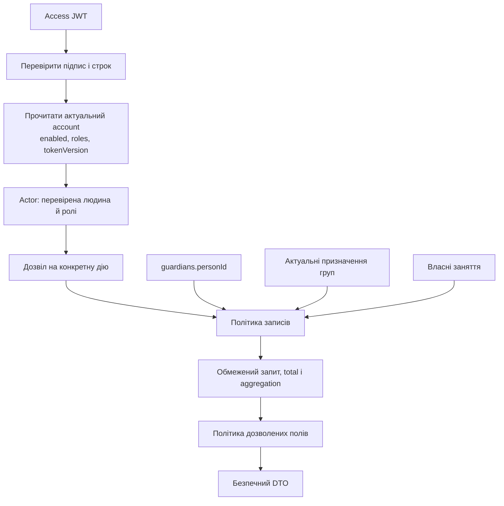

Список ролей не замінює перевірку конкретної дитини. Зарплати не потрапляють у DTO менеджера; пільги чужих дітей — у DTO вихователя; account credentials — у жодний звичайний DTO. Після вибуття свої рахунки залишаються доступними представнику.

## 12. Стани ключових сутностей

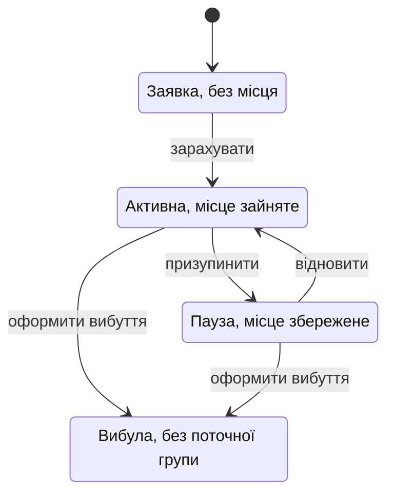

Переведення змінює членство атомарно й зберігає ACTIVE або SUSPENDED; не є повторним зарахуванням. Повернення LEFT → ACTIVE у першій версії відкладене.

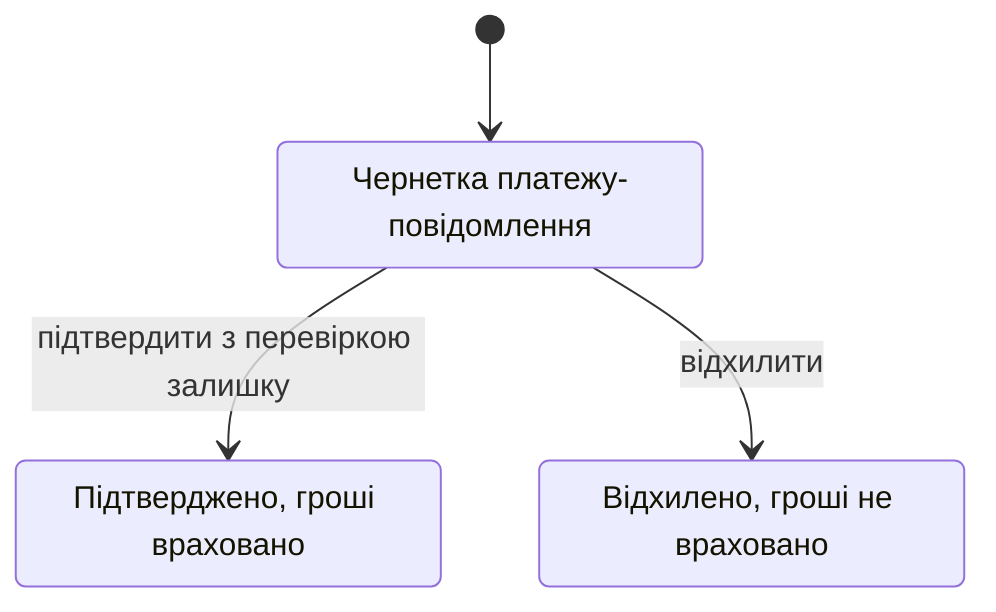

Повернення не переводить CONFIRMED у REJECTED. Створюється окремий підтверджений REFUND із посиланням на первинний RECEIPT; він може бути частковим. Стан оплати рахунку обчислюємо окремо.

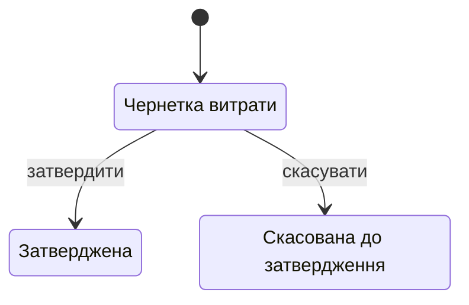

Оплата — окремий факт paidAt, а не заміна статусу APPROVED. Після затвердження виправлення є окремою корекцією, не переходом назад у DRAFT.

## 13. Наскрізні операції та атомарність

### Зарахування

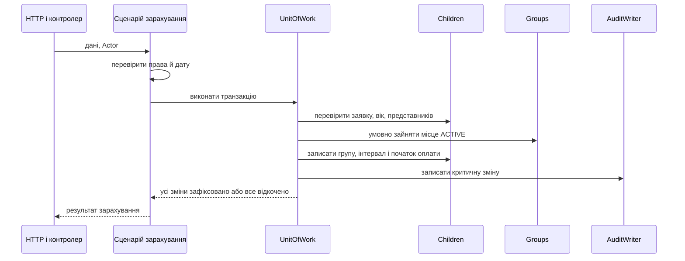

Два запити не можуть зайняти одне останнє місце. Вік/представництво й запис не розділяються без захисту від паралельної зміни.

### Вибуття та повернення

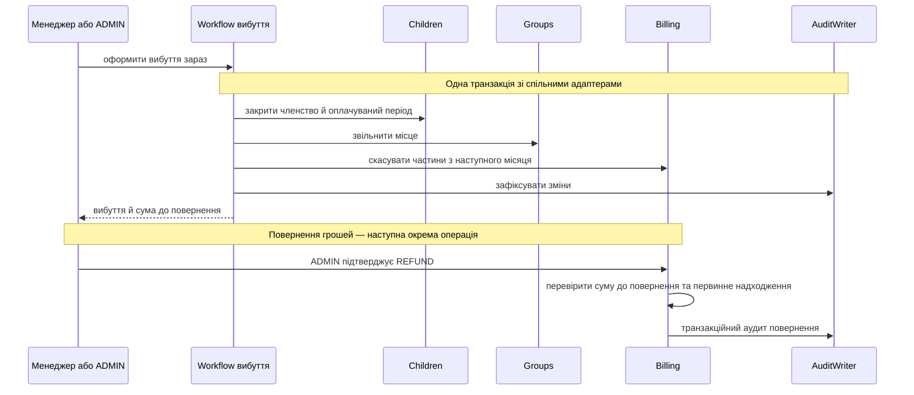

Фактичного зовнішнього банківського виклику немає. Операційний менеджер може оформити вибуття з необхідним скасуванням, але не підтверджує повернення грошей.

## 14. Залежності модулів у коді

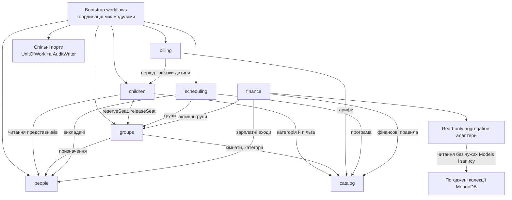

Стрілка тут означає **використовує публічний порт**, не зберігає ID. Billing читає children; тому children не повинен прямо викликати billing у зворотному напрямку. Вибуття координує Workflow, який звертається до обох. Так само немає циклу people ↔ scheduling при зміні доступності.

Сценарії різних модулів отримують AuditWriter і UnitOfWork через залежності; ці спільні порти не є новими бізнес-колекціями. Finance може читати чужі дані для звітів через погоджені aggregation-адаптери, не отримуючи права змінювати їх.

## 15. Плоскі модулі та проходження запиту

Архітектуру спрощено 12 жовтня 2026 року; бізнес-зв’язки попередніх діаграм збережені.

```mermaid
flowchart LR
    Client[Клієнт] --> Security[Middleware: tracing, Helmet, ліміти]
    Security --> Schema[Zod-схема]
    Schema --> Controller[Controller]
    Controller --> Service[Service: правила і політики]
    Service --> Repository[Repository: CRUD та aggregation]
    Repository --> Model[Mongoose model]
    Model --> DB[(MongoDB)]
    Controller --> DTO[DTO]
    DTO --> Response[Відповідь]
```

```mermaid
flowchart TB
    Module[module.js: DI] --> Service
    Module --> Controller
    Module --> Routes
    Repository -->|передається ззовні| Service
    Service -->|передається ззовні| Controller
    Controller -->|передається ззовні| Routes
```

Service не імпортує MongoDB-модель; repository повертає звичайні об’єкти зі строковим id. Великі формули можна винести в чисті functions поруч із service. Технічна структура докладно описана в docs/architecture/02_Architecture_Decisions.md.

## 16. Прогноз і дані для пошуку

```mermaid
flowchart LR
    Demand["Попит за віком"] --> Model["Чиста модель сценарію"]
    Rooms["Доступні кімнати й місткість"] --> Model
    Staff["Сценарний штат і доступність"] --> Model
    Rates["Тарифи, правила зарплати, оренда"] --> Model
    Discounts["Частки пільг і річної оплати"] --> Model
    Program["Програма за категоріями"] --> Model
    Model --> Money["Фінансовий результат<br/>і беззбитковість моделі"]
    Model --> Check["Генератор і валідатор розкладу"]
    Money --> Result["Найкращий знайдений варіант"]
    Check --> Result
    Result --> Limits["Ресурси, бюджет,<br/>непідтверджені кандидати"]
```

Сценарні працівники — вхід прогнозу, не нові записи people. Прогноз не створює групи, рахунки або витрати. Не змішуємо стабільний прогнозний місяць із безоплатним залишком місяця зарахування. Відсутня собівартість харчування означає неповну фінансову модель.

## 17. Словник вкладених і похідних сутностей

| Сутність | Власник | Зберігання / значення |
|---|---|---|
| Людина | people | Документ people |
| Обліковий запис | people | Вкладений account, 0 або 1 |
| Профіль працівника | people | Вкладений employee, 0 або 1 |
| Роль і дозвіл | people / utils | Константи й таблиця в коді; account зберігає коди ролей |
| Посада | catalog | Документ POSITION_TYPE |
| Доступність і зарплатні умови | people | Дані employee, різні призначення |
| Дитина | children | Документ children |
| Законне представництво | children | Вкладений зв’язок guardians із personId |
| Інший родич | children | Вкладений об’єкт relatives, без автоматичного входу |
| Харчові особливості | children | nutrition; не тариф і не витрата |
| Призначення пільги | children | Датований знімок виду, відсотка й умов |
| Історія членства | children | Обмежені інтервали посилань на groups |
| Оплачуваний період | children | Межі місяців, окремі від фактичного членства |
| Група | groups | Документ groups |
| Призначення вихователя й помічника | groups | Посилання на people, перевірені посади |
| Зайняті місця | groups | Технічний лічильник, не реєстр дітей |
| Навчальний рік | children / groups | Календарне значення, не колекція |
| Вік і категорія | catalog / children | Категорія catalog та результат обчислення на 1 вересня |
| Кімната | catalog | ROOM, оренда не множиться на цей запис |
| Дисципліна | catalog | DISCIPLINE |
| Програма за віком | catalog | Версійні умови кількості/тривалості занять |
| Тариф навчання / харчування | catalog | Версійні TUITION_RATE / MEAL_RATE |
| Вид пільги | catalog | BENEFIT_TYPE; не саме призначення дитині |
| Оренда й зарплатні правила | catalog | Фінансові версії SETTINGS |
| Технічний guard | repository / catalog | Змінювана ревізія, не тариф |
| Відкриття зарплатного місяця | finance | Технічна ознака в catalog, рядки в expenses |
| Розклад | scheduling | Документ schedules |
| Слот | scheduling | Вкладений у чернетку або публікацію |
| Опублікований знімок | scheduling | Вкладений у schedules, відокремлений від чернетки |
| Рахунок | billing | Документ invoices |
| Місячна частина | billing | serviceMonths, 1 або 12 на рахунок |
| Резервування місяців | billing | billableMonths, технічна унікальність |
| Знімок нарахування | billing | Умови й значення в invoices |
| Платіж / повернення | billing | Документ payments із напрямком і посиланнями |
| Витрата / коригування | finance | Документ expenses |
| Зарплатне нарахування | finance | Expense категорії SALARY, не платіж від батьків |
| Факт оплати витрати | finance | paidAt та сума в expenses, не колекція payments |
| Борг, сума до повернення, прострочення | billing / finance | Похідні поточні показники |
| Фінансовий звіт | finance | Похідний DTO з aggregation, не колекція |
| Сценарій і кандидат | finance | Вхід та результат обмеженого пошуку, без зміни реальної бази |
| Критична історія | audit | Документ audit_logs |
| Actor і requestId | service / middleware | Контекст перевіреного виклику, не колекції |
| UnitOfWork та AuditWriter | workflows / utils | Порти, не бізнес-сутності |
| Панель і OpenAPI | controller / інструменти | Клієнти/контракти API, не власники бізнес-правил |

## 18. Карта впливу змін

| Що змінюємо | Де перевірити наслідки | Що зберігаємо незмінним |
|---|---|---|
| Тариф або вид пільги | Майбутні рахунки та прогноз | Уже сформовані рахунки й оплачений рік |
| Призначення пільги | Рахунки на дату послуг, дозволені поля DTO | Старі суми й зафіксований річний відсоток |
| Категорію при новому навчальному році | Нову групу, програму, майбутній тариф харчування | Початок оплати та старі нарахування |
| Кімнату, місткість або доступність | Активні групи, зайняті місця, публікації | Історичні групи та знімки |
| Вихователя / помічника | Посаду, унікальність активних призначень, розклад | Відкритий зарплатний знімок |
| Дисципліну чи доступність викладача | Майбутній опублікований тиждень | Минулі публікації й фінансові умови |
| Членство дитини | Місця, історію, часові межі оплати | Попередню фінансову історію |
| Вибуття | Звільнення місця й скасування майбутніх частин | Минулі та поточний оплачувані місяці |
| Підтвердження платежу | Залишок, поточний борг, фактичні надходження | Тариф і початкові суми рахунку |
| Повернення | Чинне зобов’язання, первинне надходження, конкурентні ліміти | Первинний платіж і надані послуги |
| Ролі / блокування | Наступний запит, передумови посади, останнього ADMIN | Членство дитини й кадрові призначення |
| Затвердження / оплата витрати | Результат періоду / грошовий потік відповідно | Первинний знімок розрахунку |
| Харчові особливості | Доступ призначеного персоналу й представника | Формулу тарифу й зарплати |

## 19. З чого починати команді

Для кожного нового сценарію визначити: власника даних, потрібні читання, можливі зміни, права, доменні правила, атомарність і форму відповіді. Потім реалізувати мінімальні порти та перевірити позитивний, негативний і за потреби конкурентний сценарій.

Не починати з створення класу на кожний прямокутник. Прямокутник може бути вкладеним об’єктом, константою, обчисленим результатом або портом. Окремими колекціями є тільки дев’ять записів із розділу 2.

Практичний порядок: catalog і спільні адаптери → people та доступ → groups → children і зарахування → billing та expenses → scheduling і звіти → генерація та фінансові сценарії. Усі маршрути, формули й обмеження звіряти з узгодженими вимогами, а не зі старим архівним прикладом.
