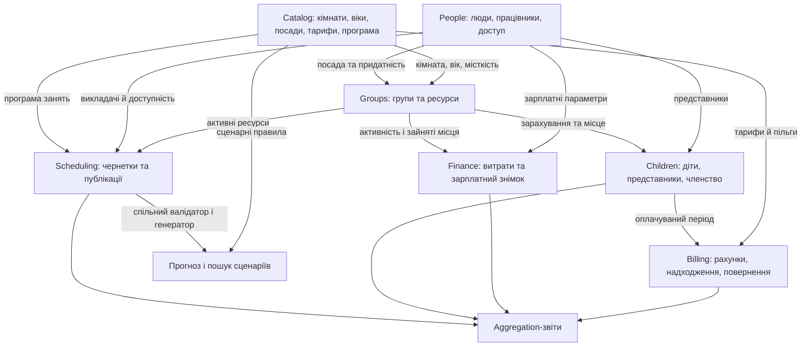
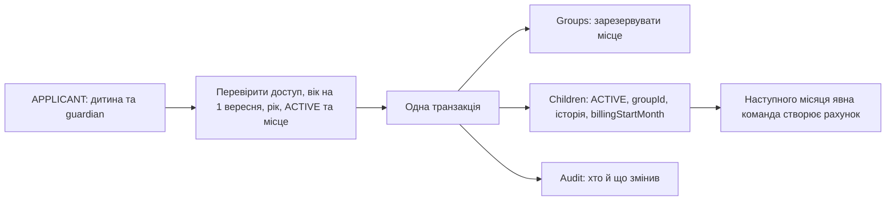
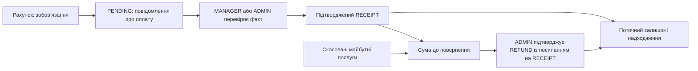

# Логічні блоки та бізнес-цепочки дитячого садка

12 жовтня 2026 року · пояснення для команди студентів.

Цей документ відповідає на три питання: хто володіє даними, хто їх використовує та що потрібно змінити разом. Він пояснює [чинні вимоги](../requirements/00_Consolidated_Requirements.md), не вводить нових правил. Конкретні постановки — у [backlog](../planning/tasks/10_Jira_Backlog.md), порядок розробки — у [командному плані](../planning/plans/09_Team_Delivery_Plan.md).

**Статус:** більшість бізнес-цепочок нижче — запланований результат. Зараз працюють DRAFT-групи, MongoDB, seed, aggregation за віком, HTTP-захист, readiness, Swagger та HTTP-tracing. Люди, вхід, діти, повні ресурси груп, billing, витрати й scheduling ще не реалізовані. Стрілка на діаграмі означає потік даних або бізнес-залежність; вона не означає, що всі ці сервіси вже є чи що потрібно зробити прямий імпорт між ними.

Для початку прочитайте загальну карту та ланцюжки 1–3. Після зарахування додайте оплату й ручний розклад; генератор та сценарії вивчайте пізніше.

## 1. Загальна карта



Права доступу й аудит застосовуються поперек цих блоків. Прогноз отримує явний сценарний знімок, а не змінює фактичні групи, дітей або штат. Панель лише читає дозволені API-відповіді.

## 2. Хто володіє даними

| Модуль | Його колекції | Головна відповідальність | Хто використовує результат |
|---|---|---|---|
| people | people | Одна людина, account, працівник, посада, доступність | Авторизація, children, groups, scheduling, finance |
| catalog | catalog | Типізовані довідники, датовані версії правил, технічні guards | Усі бізнес-модулі |
| groups | groups | Ресурси групи, стан, місткість та occupiedSeats | Children, scheduling, finance, звіти |
| children | children | Представники, харчові дані, членство й оплачуваний період | Політики доступу, groups, billing, операційні звіти |
| billing | invoices, payments | Зобов’язання, підтверджені рухи грошей, скасування й повернення | Children при вибутті, фінансові звіти, дозволені читачі |
| scheduling | schedules | Тижнева чернетка, ревізія та остання публікація | Батьки/персонал, захист змін ресурсів, звіти, сценарії |
| finance | expenses | Витрати, зарплатний знімок, звіти й сценарні розрахунки | ADMIN, панель читання |
| audit | audit_logs | Безпечна історія критичних змін | ADMIN та перевірки атомарності |

Це дев’ять колекцій. Кімнати, тарифи, пільги та посади — записи catalog, а не окремі колекції. Батько, працівник і викладач — різні зв’язки або профілі однієї людини, а не три дублікати people.

Власник виконує записи у свою колекцію. Інший модуль звертається через явну залежність service, погоджену на рівні складання. Для звітів дозволений погоджений read-only `$lookup`. Не робимо запис чужої Mongoose-моделі з controller. Якщо потрібна операція над кількома власниками, використовуємо один узгоджений workflow; не створюємо циклічних імпортів service один в одного.

## 3. Ланцюжок 1: людина → account → права → дозволені дані

```text
Одна людина people
  → необов’язковий account
  → login і перевірений actor
  → дозвіл на операцію
  → область записів: свої діти / призначена група / власні заняття
  → дозволені поля DTO
```

Посада визначає роботу й зарплату; роль визначає доступ до API. Блокування входу не звільняє працівника. TEACHER працює з власними заняттями; EDUCATOR/ASSISTANT — з призначеною групою. MANAGER керує операційною роботою без зарплат, ролей і повернень. PARENT отримує доступ через guardian-зв’язок дитини, а не через довільний childId із запиту.

Перевірка є у service, а middleware може відхилити запит раніше. Scope застосовується до пошуку, total і aggregation до пагінації. Людина з PARENT + EDUCATOR не отримує приватні фінансові поля чужих дітей. Після зміни ролі чи блокування account наступний запит перевіряє актуальний стан у people.

**Вимоги:** [§ 4](../requirements/00_Consolidated_Requirements.md#req-4), [§ 5](../requirements/00_Consolidated_Requirements.md#req-5), [§ 20](../requirements/00_Consolidated_Requirements.md#req-20).  
**Задачі:** [TASK-006](../planning/tasks/10_Jira_Backlog.md#task-006), [TASK-012](../planning/tasks/10_Jira_Backlog.md#task-012), [TASK-013](../planning/tasks/10_Jira_Backlog.md#task-013), [TASK-038](../planning/tasks/10_Jira_Backlog.md#task-038).

## 4. Ланцюжок 2: довідники + персонал → активна група

```text
Catalog: навчальна вікова категорія + групова кімната з місткістю
People: придатний вихователь + придатний помічник
  → Groups перевіряє рік, місткість, посади та вільність ресурсів
  → DRAFT переходить в ACTIVE
  → група дозволяє зарахування та бере участь у розкладі й зарплатному знімку
```

Вихователь і помічник — різні люди. Кімната або людина не можуть одночасно обслуговувати дві ACTIVE-групи, зокрема через різні ролі призначення. Службова кімната не підходить. Порожня ACTIVE-група все одно займає кімнату й персонал та має базову зарплату пари.

Точка перетину — конкурентне призначення: спільна серіалізація ресурсів і аудит у транзакції. Два окремі unique-index для educator/assistant не захищають від перехресного призначення однієї людини. Після появи published schedule зміна ресурсу також перевіряє майбутні тижні. Зміна навчального року — явна передача ресурсів, не автоматичне дублювання групи.

**Вимоги:** [§ 7](../requirements/00_Consolidated_Requirements.md#req-7), [§ 19.4](../requirements/00_Consolidated_Requirements.md#req-19-4).  
**Задачі:** [TASK-007](../planning/tasks/10_Jira_Backlog.md#task-007), [TASK-014](../planning/tasks/10_Jira_Backlog.md#task-014), [TASK-015](../planning/tasks/10_Jira_Backlog.md#task-015), [TASK-024](../planning/tasks/10_Jira_Backlog.md#task-024).

## 5. Ланцюжок 3: представник + дитина + група → зарахування



До зарахування дитина не займає місця. Зарахування діє зараз за серверним часом, потребує щонайменше одного представника та відповідної вікової категорії. Резервування місця, стан дитини, історія й аудит — одна операція: при помилці відкочується все.

Приклад: дитину зараховано 15 жовтня. Місце зайняте одразу, перший оплачуваний місяць — листопад. Зарахування не створює жовтневий борг і не запускає всі рахунки автоматично. Дві одночасні спроби на останнє місце дають один успіх.

**Вимоги:** [§ 6](../requirements/00_Consolidated_Requirements.md#req-6), [§ 8](../requirements/00_Consolidated_Requirements.md#req-8).  
**Задачі:** [TASK-008](../planning/tasks/10_Jira_Backlog.md#task-008), [TASK-016](../planning/tasks/10_Jira_Backlog.md#task-016), [TASK-017](../planning/tasks/10_Jira_Backlog.md#task-017), [TASK-011](../planning/tasks/10_Jira_Backlog.md#task-011).

## 6. Ланцюжок 4: стан дитини → місце, оплата й наступна зарплата

| Команда | Groups і Children | Billing | Finance / Scheduling |
|---|---|---|---|
| Переведення | Нове місце резервується, старе звільняється; історія оновлена атомарно | Початковий billingStartMonth збережений; нового безоплатного місяця немає | Наступний зарплатний знімок бачить новий склад; published ресурси залишаються валідними |
| Пауза | SUSPENDED продовжує займати місце | Нарахування триває | Дитина враховується в occupiedSeats для зарплатного знімка |
| Відновлення | ACTIVE у тому самому членстві | Немає нового пільгового вступного періоду | Уже створена зарплата не перераховується |
| Вибуття | LEFT і звільнення місця одразу; історія збережена | Поточний оплачуваний місяць лишається; наступні частини скасовуються | Наступний знімок врахує менший склад; сам розклад групи не зникає |

Вибуття перетинає children, groups, billing та audit в одній транзакції. Якщо скасування частин рахунку неуспішне, не можна окремо звільнити місце й залишити неправильні зобов’язання. Фактичне повернення коштів — наступна окрема команда ADMIN.

Приклад: зараховано в жовтні, вибуття 12 лютого → оплачувані листопад–лютий; березень і далі скасовані. Guardian-зв’язок зберігає доступ до історичних рахунків LEFT-дитини. Повторне зарахування LEFT у першій версії відкладено.

**Вимоги:** [§ 8](../requirements/00_Consolidated_Requirements.md#req-8), [§ 11.5](../requirements/00_Consolidated_Requirements.md#req-11-5).  
**Задачі:** [TASK-017](../planning/tasks/10_Jira_Backlog.md#task-017), [TASK-026](../planning/tasks/10_Jira_Backlog.md#task-026), [TASK-027](../planning/tasks/10_Jira_Backlog.md#task-027), [TASK-029](../planning/tasks/10_Jira_Backlog.md#task-029).

## 7. Ланцюжок 5: тарифи + пільга + оплачуваний період → рахунок

```text
Children: billingStartMonth / billingEndMonth та призначення пільги
Catalog: версія тарифу й умов на потрібну дату
Спільні money/calendar
  → Billing перевіряє право на нарахування й відсутність перетину місяців
  → Invoice з незмінним snapshot тарифу, пільги, формули та month parts
```

Місячне навчання враховує персональну пільгу; харчування — тариф відповідного віку × усі будні місяця, без пільги за навчання. Майбутня версія тарифу не переписує старий рахунок. Відсутній тариф — помилка, не нульова ціна.

Annual — 12 послідовних місяців із тарифом і персональною пільгою першого місяця; після персональної знижки застосовується 12% річної. 15 000 × 12 × 0,90 × 0,88 = 142 560 грн. Залишкові копійки розподіляються між першими частинами, їх сума точно дорівнює invoice.

Annual та monthly tuition використовують спільне резервування child/service/month, щоб не виставити два зобов’язання за ту саму послугу. Annual потребує повного своєчасного підтвердження перед початком; неоплачений прострочений рік не додає доходу. Перехід на monthly — явна повторювана команда, без cron. Meals залишаються місячними.

**Вимоги:** [§ 9](../requirements/00_Consolidated_Requirements.md#req-9), [§ 10](../requirements/00_Consolidated_Requirements.md#req-10), [§ 11](../requirements/00_Consolidated_Requirements.md#req-11).  
**Задачі:** [TASK-004](../planning/tasks/10_Jira_Backlog.md#task-004), [TASK-005](../planning/tasks/10_Jira_Backlog.md#task-005), [TASK-018](../planning/tasks/10_Jira_Backlog.md#task-018), [TASK-019](../planning/tasks/10_Jira_Backlog.md#task-019), [TASK-025](../planning/tasks/10_Jira_Backlog.md#task-025).

## 8. Ланцюжок 6: рахунок → повідомлення → підтверджені гроші → повернення



PENDING або REJECTED не є надходженням. Confirm атомарно змінює payment, підсумки invoice та audit; два одночасні підтвердження не роблять переплату. Час фактичних грошей occurredAt і серверний confirmedAt — різні поля.

Після cancellation поточне зобов’язання дорівнює сумі нескасованих частин; чиста оплата — receipts мінус refunds. Outstanding = max(0, зобов’язання − чиста оплата), refundDue = max(0, чиста оплата − зобов’язання). Змінені залишки не переписують origAmount або старий receipt.

Приклад: оплачений annual 142 560 грн, використано 3 частини → зобов’язання 35 640 грн, refundDue 106 920 грн. До фактичного refund гроші ще не повернуті. Після підтвердження повернення outstanding і refundDue нуль. Refund обмежений і сумою до повернення, і невідшкодованою сумою конкретного receipt.

**Вимоги:** [§ 11.5](../requirements/00_Consolidated_Requirements.md#req-11-5), [§ 12](../requirements/00_Consolidated_Requirements.md#req-12).  
**Задачі:** [TASK-020](../planning/tasks/10_Jira_Backlog.md#task-020), [TASK-021](../planning/tasks/10_Jira_Backlog.md#task-021), [TASK-026](../planning/tasks/10_Jira_Backlog.md#task-026), [TASK-027](../planning/tasks/10_Jira_Backlog.md#task-027), [TASK-031](../planning/tasks/10_Jira_Backlog.md#task-031).

## 9. Ланцюжок 7: харчові дані → дозволений перегляд; тариф → рахунок; закупівля → витрата

| Гілка | Джерело | Результат | Не змішуємо з |
|---|---|---|---|
| Безпечне харчування | Children: вподобання, алергічні примітки, виключені продукти | Дозволені дані своєї дитини або призначеної групи | Медичними діагнозами чи доступом teacher до всіх дітей |
| Оплата харчування | Catalog: віковий meal tariff; календар буднів | Billing: місячний MEAL-invoice | Собівартістю продуктів та щоденною відвідуваністю |
| Витрати на продукти | ADMIN: фактична expense FOOD | Затверджена витрата, потім її оплата | Ціною, яку виставляємо батькам |
| Час харчування | Fixed blocks тижня | Scheduling блокує ці інтервали для занять | Тарифом або рахунком |

Зміна харчових вподобань не перераховує автоматично invoice. Пільга за навчання не зменшує meals. Без введених витрат на продукти фінансова модель не може називати результат повним прибутком.

**Вимоги:** [§ 6](../requirements/00_Consolidated_Requirements.md#req-6), [§ 11.3](../requirements/00_Consolidated_Requirements.md#req-11-3), [§ 13.1](../requirements/00_Consolidated_Requirements.md#req-13-1), [§ 14.2](../requirements/00_Consolidated_Requirements.md#req-14-2).  
**Задачі:** [TASK-016](../planning/tasks/10_Jira_Backlog.md#task-016), [TASK-019](../planning/tasks/10_Jira_Backlog.md#task-019), [TASK-028](../planning/tasks/10_Jira_Backlog.md#task-028), [TASK-022](../planning/tasks/10_Jira_Backlog.md#task-022).

## 10. Ланцюжок 8: персонал + зайняті місця → зарплатний знімок → витрати

```text
ADMIN відкриває поточний місяць уперше
  → знімок фактичного штату, параметрів і ACTIVE-груп на цю дату
  → occupiedSeats включає ACTIVE та SUSPENDED дітей
  → точний розрахунок зарплат + одна оренда будинку
  → expenses зі стабільними sourceKeys + marker місяця + audit в одній транзакції
  → затвердження витрат → окреме підтвердження їх оплати
```

При 20 дітях: вихователь 80 000 грн, помічник 44 000 грн, разом 124 000 грн. Порожня ACTIVE-група має 60 000 грн базової зарплати пари. Оренда 50 000 грн за будинок не множиться на кімнати. Роль account не визначає зарплату.

Повторне відкриття повертає збережений результат. Дитину перевели або працівнику змінили параметр після знімка — цей місяць не перераховується автоматично; зміна врахується у наступному знімку. Для обґрунтованого поточного виправлення є окрема витрата/корекція. Пропущені минулі місяці не будуються з поточних people/groups.

**Вимоги:** [§ 13](../requirements/00_Consolidated_Requirements.md#req-13).  
**Задачі:** [TASK-014](../planning/tasks/10_Jira_Backlog.md#task-014), [TASK-017](../planning/tasks/10_Jira_Backlog.md#task-017), [TASK-028](../planning/tasks/10_Jira_Backlog.md#task-028), [TASK-029](../planning/tasks/10_Jira_Backlog.md#task-029).

## 11. Ланцюжок 9: групи + викладачі + програма → чернетка → публікація

```text
Catalog: програма на тиждень + fixed blocks
Groups: ACTIVE, рік, кімната
People: дисципліна викладача та availability
  → явний snapshot для спільного валідатора
  → draft із revision
  → перевірка повноти, інтервалів і конфліктів
  → повторна перевірка актуальних ресурсів під транзакційним guard
  → published snapshot + audit
  → дозволений перегляд і звіт навантаження
```

Draft і останній published snapshot існують окремо. Редагування чернетки не змінює опубліковані заняття. PARENT читає лише published своєї групи; TEACHER змінює тільки час власного слота в draft. Stale revision дає 409, а не перезаписує чужі зміни.

Найважливіший перетин: people/groups/catalog можуть змінити ресурс, використаний публікацією. Publish і такі зміни використовують спільний guard. Несумісну зміну відхиляємо або робимо узгоджену заміну ресурсів і перепублікацію зачеплених тижнів однією транзакцією. Публікація не далі 4 тижнів уперед. Звільнення викладача не повинно залишити заняття з непридатним працівником.

Генератор — окрема наступна команда: використовує той самий validator, повертає draft та причини незапланованих занять. Сам не публікує. Невдалий пошук у межах бюджету не доводить неможливість розкладу.

**Вимоги:** [§ 14](../requirements/00_Consolidated_Requirements.md#req-14), [§ 19.4](../requirements/00_Consolidated_Requirements.md#req-19-4).  
**Задачі:** [TASK-018](../planning/tasks/10_Jira_Backlog.md#task-018), [TASK-022](../planning/tasks/10_Jira_Backlog.md#task-022), [TASK-023](../planning/tasks/10_Jira_Backlog.md#task-023), [TASK-024](../planning/tasks/10_Jira_Backlog.md#task-024), [TASK-034](../planning/tasks/10_Jira_Backlog.md#task-034).

## 12. Ланцюжок 10: факти → aggregation → фінансовий результат і панель

| Показник | Дані | Дата або період |
|---|---|---|
| Наповненість | Children ACTIVE/SUSPENDED + groups, включно з порожніми | Поточний стан |
| Нарахований дохід | Чинні month parts invoices; для annual — правила повної оплати | serviceMonth |
| Чисті надходження | Confirmed receipts мінус refunds | occurredAt |
| Витрати | Approved expenses та корекції | serviceMonth |
| Оплачені витрати | Підтверджена оплата expenses | Фактична дата оплати |
| Борг/прострочення/refundDue | Чинні зобов’язання та підтверджені рухи | Зараз, з asOf |
| Навантаження викладача | Опубліковані заняття | Вибраний тиждень |

Результат = нарахований дохід − витрати періоду. Cash flow = чисті надходження − фактично оплачені витрати. Annual receipt може надійти одним платежем, а дохід розподіляється на 12 місяців. Приєднання багатьох payments не повинно множити суму invoice.

Фактичні звіти використовують MongoDB Aggregation Framework. Scope діє перед aggregation. Якщо в минулому місяці бракує витрат або зараз підтверджено стару операцію, звіт показує примітки й актуальні факти. Поточний борг не підписуємо як борг на кінець вибраного минулого місяця.

Панель отримує готові DTO, не рахує свої фінансові формули. API-помилка дає стан помилки, а не підміну фейковими цифрами. Demo-mode із вигаданими даними явно відокремлений від API-mode.

**Вимоги:** [§ 15](../requirements/00_Consolidated_Requirements.md#req-15), [§ 21](../requirements/00_Consolidated_Requirements.md#req-21).  
**Задачі:** [TASK-010](../planning/tasks/10_Jira_Backlog.md#task-010), [TASK-030](../planning/tasks/10_Jira_Backlog.md#task-030), [TASK-031](../planning/tasks/10_Jira_Backlog.md#task-031), [TASK-032](../planning/tasks/10_Jira_Backlog.md#task-032), [TASK-033](../planning/tasks/10_Jira_Backlog.md#task-033), [TASK-037](../planning/tasks/10_Jira_Backlog.md#task-037).

## 13. Ланцюжок 11: сценарний попит + ресурси → прогноз → перевірка розкладу

```text
Явні сценарні demand/age, тарифи, discount mix, кімнати, штат і витрати
  → чистий прогноз для стабільного місяця
  → беззбитковість за фіксованим способом розподілу
  → кандидати конфігурацій, які обслуговують весь заданий попит
  → той самий scheduling generator + validator на сценарних ресурсах
  → найкращий знайдений підтверджений варіант + непідтверджені + причини й бюджет
```

Фінансово вигідний набір ще може не мати підтвердженого розкладу. Вік не змішуємо; кімнати й educator/assistant потрібні кожній групі. Сценарних працівників не записуємо в people. Search має спільний бюджет для вкладених генераторів, не 1000 незалежних повних пошуків.

Прогноз не змінює дітей, зарплатні витрати чи invoices. Він явно пояснює допущення стабільного місяця, склад витрат та межі пошуку. «Найкращий знайдений» не означає глобальний оптимум. Відсутній food cost робить оцінку неповною.

**Вимоги:** [§ 16](../requirements/00_Consolidated_Requirements.md#req-16), [§ 17](../requirements/00_Consolidated_Requirements.md#req-17).  
**Задачі:** [TASK-034](../planning/tasks/10_Jira_Backlog.md#task-034), [TASK-035](../planning/tasks/10_Jira_Backlog.md#task-035), [TASK-036](../planning/tasks/10_Jira_Backlog.md#task-036).

## 14. Технічний ланцюжок одного запиту

```text
HTTP → спільний захист і requestId → authentication/permission → schema входу
  → controller → service: actor, scope та бізнес-правила
  → repository: MongoDB / aggregation / одна session для атомарної команди
  → DTO з дозволеними полями → HTTP-відповідь
```

Authentication/permission та бізнес-аудит у цьому шляху заплановані; наявний groups поки має захист HTTP і Zod без ролей. DI збирає залежності через конструктори. Service не знає Express, controller не робить MongoDB-запитів. HTTP-tracing працює глобально, без ручних обгорток кожного модуля, і не замінює audit.

Swagger має власний шлях: schema + module.openapi → спільний збирач → OpenAPI → UI. Це документація контракту, не механізм авторизації чи виконання бізнес-правил. /health/live перевіряє процес; /health/ready використовує існуюче MongoDB-з’єднання й ping через DI, повертаючи 200 або 503.

**Задачі:** [TASK-001](../planning/tasks/10_Jira_Backlog.md#task-001), [TASK-002](../planning/tasks/10_Jira_Backlog.md#task-002), [TASK-003](../planning/tasks/10_Jira_Backlog.md#task-003), [TASK-011](../planning/tasks/10_Jira_Backlog.md#task-011), [TASK-013](../planning/tasks/10_Jira_Backlog.md#task-013).  
**Як писати:** [архітектура](02_Architecture_Decisions.md), [Swagger](../development/11_OpenAPI_Generation.md), [запуск](../development/06_Local_Startup.md).

## 15. Матриця найважливіших перетинів

| Що змінюємо | Кого зачіпає | Що перевірити або змінити разом |
|---|---|---|
| Account roles/enabled | Усі захищені модулі | Актуальні права на наступному запиті; останнього ADMIN не втрачено |
| Кімнату/educator/assistant ACTIVE-групи | Groups, people, scheduling | Ресурс вільний, published лишається валідним, зміна під спільним guard |
| Місткість групи | Groups, children | Не нижче occupiedSeats і не вище кімнати; без прихованого виключення дітей |
| Членство дитини | Children, groups, billing, audit | Місця та історія атомарні; вибуття включає cancellation, не сам refund |
| Тариф/пільгу | Catalog, children, billing, finance | Датовані умови майбутніх розрахунків; старі snapshots збережені |
| Підтвердження payment/refund | Billing, audit, звіти | Залишки й audit атомарні; idempotency та захист від переплати |
| Штат/occupiedSeats після відкриття місяця | People/groups, finance | Уже збережена зарплата незмінна; наступний snapshot побачить зміну |
| Доступність/дисципліну teacher | People, scheduling | Не зламати майбутній published, одна дисципліна на працівника |
| Published schedule | Scheduling, people, groups, catalog, audit | Повторна валідація й guard у транзакції; draft окремий |
| Формат відповіді API | DTO, schema, OpenAPI, тести, панель | Одна погоджена зміна контракту; панель не використовує старі поля |

Транзакційно разом виконуються місця + членство + аудит; вибуття також включає billing cancellation; підтвердження грошей — payment + invoice totals + audit; відкриття місяця — marker + усі авто-витрати + audit; публікація — перевірені ресурси під guard + published + audit. Це не одна транзакція на всю систему. Звіти й прогноз не перезаписують ці факти.

## 16. Як використати документ у задачі

Перед кодом знайдіть бізнес-ланцюжок і відповідні TASK-посилання. Назвіть команду, власника запису, вхід від інших модулів, правила доступу, результат та атомарну межу. Погодьте вузькі методи service/repository зі споживачами. Після цього реалізуйте один завершений сценарій з негативними й потрібними конкурентними перевірками.

При зміні поля або правила пройдіть матрицю перетинів: кого зачепить новий DTO, чи потрібна нова версія, що має лишитися історичним і чи не потрібен спільний guard. Оновіть ТЗ, пов’язані картки та OpenAPI разом із кодом. Не додавайте прямий запис чужої колекції, щоб тимчасово обійти незавершену залежність.
