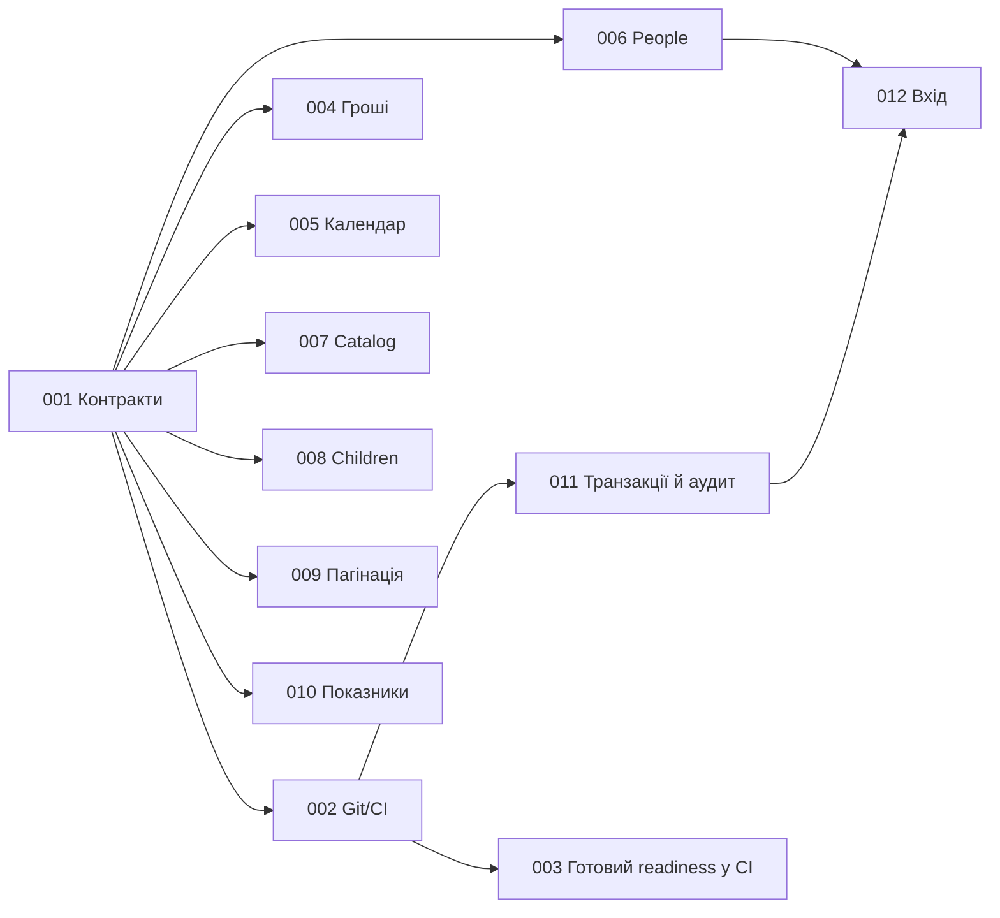
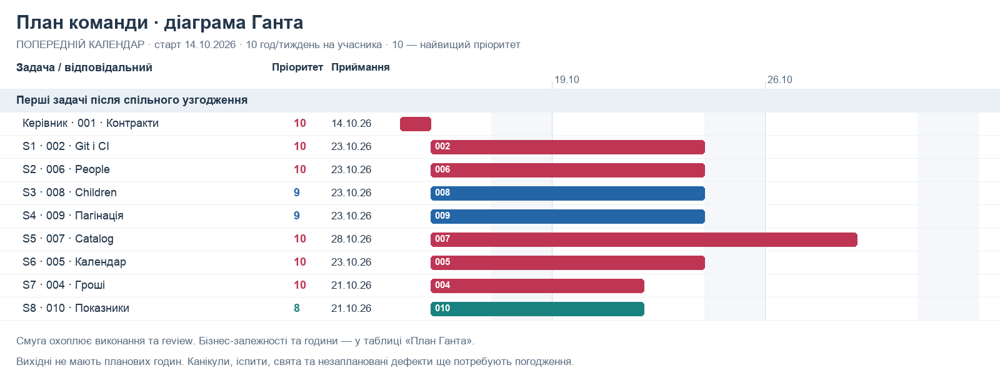
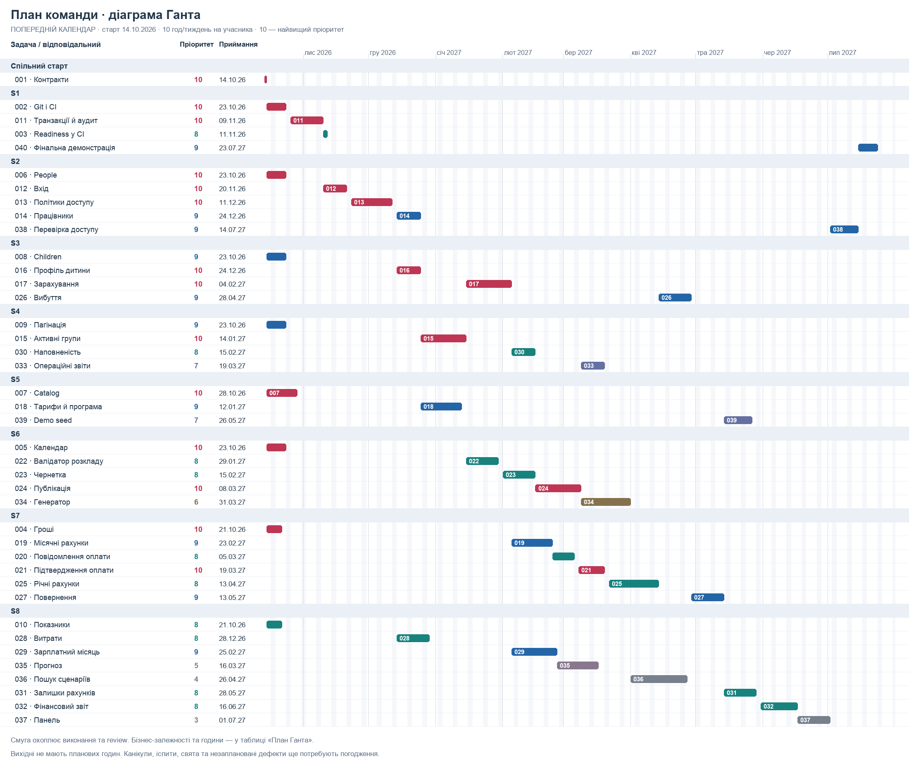
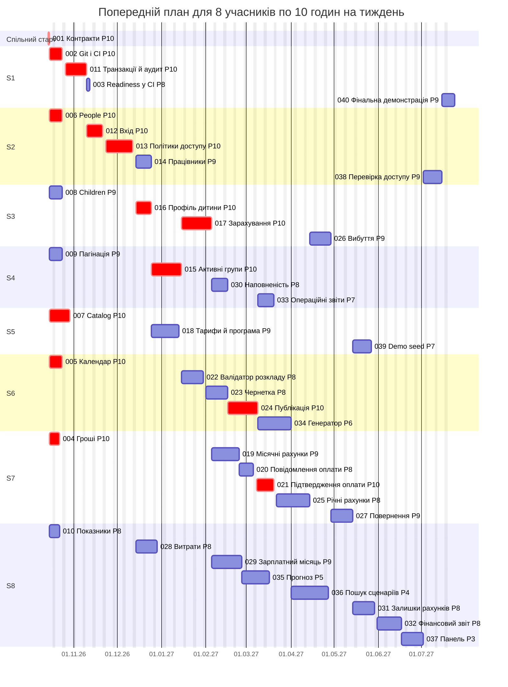

# Діаграма Ганта та пріоритети командних задач

Оновлено 13 жовтня 2026 року · **попередній календар для обговорення**, не погоджений дедлайн.

Тут видно, що можна почати, коли задача має бути прийнята, хто виконує роботу та що її блокує. Детальні кроки, вхід, результат і перевірки кожної задачі зберігаються в [backlog](../tasks/10_Jira_Backlog.md). Бізнес-правила — у [ТЗ](../../requirements/00_Consolidated_Requirements.md), взаємодія модулів — у [бізнес-ланцюжках](../../architecture/12_Business_Flows.md).

> **Фактичне оновлення 18.10.2026:** TASK-009 реалізовано й локально перевірено; командне review ще попереду. Задачі між учасниками поки не розподілено: S1–S8 і дати нижче залишаються початковими припущеннями. Графіки показують попередній план, а не фактичний прогрес; календар не перераховано.

## 1. Допущення календаря

| Параметр | Значення розрахунку |
|---|---|
| Старт | 14.10.2026, спільна сесія TASK-001 |
| Команда | 8 студентів S1–S8; керівник проводить стартове узгодження |
| Час учасника | 10 год/тиждень: до 2 год кожного буднього дня на власну роботу та review разом |
| Вихідні | Субота й неділя без планових годин |
| Оцінка картки | Години власника включають реалізацію, її тести та українські docs |
| Review | S: 0,5 год; M: 1 год; L: 2 год додатково в календарі reviewer |
| WIP | Одна власна задача до приймання; review іншого PR можливий у межах тих самих 2 год/день |
| Початок залежної задачі | Наступний будній день після приймання всіх бізнес-залежностей |
| Спільні сесії | TASK-001 — 2 год усіх; фінальна сесія TASK-040 — 2 год усіх після підготовки S1 |
| Невраховані паузи | Канікули, іспити, свята, відсутність доступів, незаплановані дефекти; додати після погодження календаря |

Поки команда не підтвердила старт і години, дати є прикладом планування. Оцінки потребують review виконавця, особливо L-сценарії, які треба розбити на підзадачі. Час очікування залежностей не є годинами роботи; колега може допомагати з review, тестовими прикладами та парною розробкою. Після першої порції задач оцінки калібруємо за фактом.

У календарі readiness TASK-003 має тільки 2 год на інтеграцію вже написаного коду, а не повторну реалізацію. Git/CI та більшість бізнес-модулів ще потрібно зробити.

## 2. Як вибрати наступну задачу

1. Відкрити таблицю нижче та перейти в детальну картку.
2. Перевірити, що всі `Blocked by` прийняті, а контракти й права погоджені.
3. Перевірити власну активну задачу та доступність reviewer.
4. Серед Ready-задач брати найбільший пріоритет; при однаковому — ту, що розблоковує найближчий командний результат.
5. Після review й злиття оновити факт завершення, розблоковані картки та календар. Прострочена залежність переносить залежні роботи.

**10 — найвищий пріоритет, 1 — найнижчий.** Висока цифра не скасовує залежності. Нижчий пріоритет не вилучає задачу з узгоджених вимог. Захист і тести входять у кожний сценарій; TASK-038 — додаткова перевірка стиків.

| Пріоритет | Для чого |
|---|---|
| 10 | Основи, доступ, безпечне зарахування та ключові операції грошей/ресурсів |
| 8–9 | Основні операційні сценарії, зарплата, звіти, командні перевірки |
| 5–7 | Генерація та прогноз після накопичення перевірених даних |
| 1–4 | Пізні допоміжні можливості; беруться після потрібної основи |

## 3. Перша порція робіт

Спочатку TASK-001. Потім по одній незалежній підготовчій задачі на учасника. До готовності Git допускається локальна підготовка; спільне злиття проходить через TASK-002. Наведені дати вже враховують час review.

| Учасник | Перша задача | Пріоритет | Початок | Приймання |
|---|---|---:|---|---|
| S1 | [TASK-002](../tasks/10_Jira_Backlog.md#task-002) — Налаштувати спільний Git-процес та CI | 10 | 15.10.2026 | 23.10.2026 |
| S2 | [TASK-006](../tasks/10_Jira_Backlog.md#task-006) — Підготувати модель people та безпечні DTO | 10 | 15.10.2026 | 23.10.2026 |
| S3 | [TASK-008](../tasks/10_Jira_Backlog.md#task-008) — Підготувати children та правила станів заявника | 9 | 15.10.2026 | 23.10.2026 |
| S4 | [TASK-009](../tasks/10_Jira_Backlog.md#task-009) — Додати пагінацію наявного списку груп | 9 | 15.10.2026 | 23.10.2026 |
| S5 | [TASK-007](../tasks/10_Jira_Backlog.md#task-007) — Підготувати типізований catalog та початкові ресурси | 10 | 15.10.2026 | 28.10.2026 |
| S6 | [TASK-005](../tasks/10_Jira_Backlog.md#task-005) — Реалізувати календар та керований Clock | 10 | 15.10.2026 | 23.10.2026 |
| S7 | [TASK-004](../tasks/10_Jira_Backlog.md#task-004) — Реалізувати спільні точні розрахунки грошей | 10 | 15.10.2026 | 21.10.2026 |
| S8 | [TASK-010](../tasks/10_Jira_Backlog.md#task-010) — Узгодити контракт фінансових показників на прикладі | 8 | 15.10.2026 | 21.10.2026 |

[Векторна схема першої порції для збільшення](assets/13_Gantt_First_Wave.svg).

Діаграма показує тільки першу порцію; повний перелік бізнес-залежностей — у таблиці всіх задач.

## 4. Повна діаграма Ганта

[Векторна діаграма для збільшення або друку](assets/13_Gantt_Plan.svg).

Смуги — календар від початку до приймання, включно з review/очікуванням. Години автора та фактичний дедлайн приймання дивіться в таблиці. Для відображення повного дня приймання правий край смуги заданий початком наступної календарної дати. Червоні смуги підсвічують пріоритет 10. Визначення критичного шляху потребує окремого аналізу залежностей і ресурсів; червоний колір тут означає пріоритет.

Редагована Mermaid-версія діаграми

## 5. Календар усіх задач

`Год` — власна робота; review окремо заброньований у reviewer. `Дні` — будні між початком і прийманням, включно з очікуванням; це не person-days. Планове приймання означає виконані критерії, review та злиття. TASK-001 — спільне узгодження до старту гілок.

| ID / деталі | Задача | Пріоритет | Власник → reviewer | Год | Дні | Початок | Приймання | Бізнес-залежності |
|---|---|---:|---|---:|---:|---|---|---|
| [TASK-001](../tasks/10_Jira_Backlog.md#task-001) | Узгодити перші контракти та правила командної роботи | 10 | Керівник → S1–S8 | 2 | 1 | 14.10.2026 | 14.10.2026 | — |
| [TASK-002](../tasks/10_Jira_Backlog.md#task-002) | Налаштувати спільний Git-процес та CI | 10 | S1 → S4 | 12 | 7 | 15.10.2026 | 23.10.2026 | [TASK-001](../tasks/10_Jira_Backlog.md#task-001) |
| [TASK-004](../tasks/10_Jira_Backlog.md#task-004) | Реалізувати спільні точні розрахунки грошей | 10 | S7 → S8 | 8 | 5 | 15.10.2026 | 21.10.2026 | [TASK-001](../tasks/10_Jira_Backlog.md#task-001) |
| [TASK-005](../tasks/10_Jira_Backlog.md#task-005) | Реалізувати календар та керований Clock | 10 | S6 → S5 | 12 | 7 | 15.10.2026 | 23.10.2026 | [TASK-001](../tasks/10_Jira_Backlog.md#task-001) |
| [TASK-006](../tasks/10_Jira_Backlog.md#task-006) | Підготувати модель people та безпечні DTO | 10 | S2 → S3 | 12 | 7 | 15.10.2026 | 23.10.2026 | [TASK-001](../tasks/10_Jira_Backlog.md#task-001) |
| [TASK-007](../tasks/10_Jira_Backlog.md#task-007) | Підготувати типізований catalog та початкові ресурси | 10 | S5 → S6 | 16 | 10 | 15.10.2026 | 28.10.2026 | [TASK-001](../tasks/10_Jira_Backlog.md#task-001) |
| [TASK-008](../tasks/10_Jira_Backlog.md#task-008) | Підготувати children та правила станів заявника | 9 | S3 → S2 | 12 | 7 | 15.10.2026 | 23.10.2026 | [TASK-001](../tasks/10_Jira_Backlog.md#task-001) |
| [TASK-009](../tasks/10_Jira_Backlog.md#task-009) | Додати пагінацію наявного списку груп | 9 | S4 → S1 | 8 | 7 | 15.10.2026 | 23.10.2026 | [TASK-001](../tasks/10_Jira_Backlog.md#task-001) |
| [TASK-010](../tasks/10_Jira_Backlog.md#task-010) | Узгодити контракт фінансових показників на прикладі | 8 | S8 → S7 | 4 | 5 | 15.10.2026 | 21.10.2026 | [TASK-001](../tasks/10_Jira_Backlog.md#task-001) |
| [TASK-011](../tasks/10_Jira_Backlog.md#task-011) | Додати малу транзакцію та бізнес-аудит | 10 | S1 → S2 | 20 | 11 | 26.10.2026 | 09.11.2026 | [TASK-002](../tasks/10_Jira_Backlog.md#task-002) |
| [TASK-012](../tasks/10_Jira_Backlog.md#task-012) | Реалізувати bootstrap адміністратора та login | 10 | S2 → S1 | 16 | 9 | 10.11.2026 | 20.11.2026 | [TASK-006](../tasks/10_Jira_Backlog.md#task-006), [TASK-011](../tasks/10_Jira_Backlog.md#task-011) |
| [TASK-003](../tasks/10_Jira_Backlog.md#task-003) | Підключити GET /health/ready до перевірки MongoDB | 8 | S1 → S4 | 2 | 2 | 10.11.2026 | 11.11.2026 | [TASK-002](../tasks/10_Jira_Backlog.md#task-002) |
| [TASK-013](../tasks/10_Jira_Backlog.md#task-013) | Додати політики доступу й керування account | 10 | S2 → S3 | 28 | 15 | 23.11.2026 | 11.12.2026 | [TASK-012](../tasks/10_Jira_Backlog.md#task-012), [TASK-008](../tasks/10_Jira_Backlog.md#task-008), [TASK-009](../tasks/10_Jira_Backlog.md#task-009), [TASK-011](../tasks/10_Jira_Backlog.md#task-011), [TASK-007](../tasks/10_Jira_Backlog.md#task-007) |
| [TASK-016](../tasks/10_Jira_Backlog.md#task-016) | Додати захищене створення заявника та профіль дитини | 10 | S3 → S2 | 16 | 9 | 14.12.2026 | 24.12.2026 | [TASK-008](../tasks/10_Jira_Backlog.md#task-008), [TASK-005](../tasks/10_Jira_Backlog.md#task-005), [TASK-013](../tasks/10_Jira_Backlog.md#task-013), [TASK-011](../tasks/10_Jira_Backlog.md#task-011) |
| [TASK-014](../tasks/10_Jira_Backlog.md#task-014) | Додати профіль працівника та доступність | 9 | S2 → S6 | 16 | 9 | 14.12.2026 | 24.12.2026 | [TASK-007](../tasks/10_Jira_Backlog.md#task-007), [TASK-013](../tasks/10_Jira_Backlog.md#task-013), [TASK-011](../tasks/10_Jira_Backlog.md#task-011) |
| [TASK-028](../tasks/10_Jira_Backlog.md#task-028) | Додати ручні витрати, approval та оплату | 8 | S8 → S1 | 20 | 11 | 14.12.2026 | 28.12.2026 | [TASK-004](../tasks/10_Jira_Backlog.md#task-004), [TASK-013](../tasks/10_Jira_Backlog.md#task-013), [TASK-011](../tasks/10_Jira_Backlog.md#task-011) |
| [TASK-015](../tasks/10_Jira_Backlog.md#task-015) | Довести групу до керування ресурсами й активації | 10 | S4 → S1 | 28 | 15 | 25.12.2026 | 14.01.2027 | [TASK-007](../tasks/10_Jira_Backlog.md#task-007), [TASK-014](../tasks/10_Jira_Backlog.md#task-014), [TASK-013](../tasks/10_Jira_Backlog.md#task-013), [TASK-011](../tasks/10_Jira_Backlog.md#task-011) |
| [TASK-018](../tasks/10_Jira_Backlog.md#task-018) | Додати версії тарифів, пільги та програму занять | 9 | S5 → S7 | 24 | 13 | 25.12.2026 | 12.01.2027 | [TASK-007](../tasks/10_Jira_Backlog.md#task-007), [TASK-004](../tasks/10_Jira_Backlog.md#task-004), [TASK-005](../tasks/10_Jira_Backlog.md#task-005), [TASK-013](../tasks/10_Jira_Backlog.md#task-013), [TASK-011](../tasks/10_Jira_Backlog.md#task-011), [TASK-016](../tasks/10_Jira_Backlog.md#task-016) |
| [TASK-017](../tasks/10_Jira_Backlog.md#task-017) | Реалізувати зарахування, переведення, паузу й відновлення | 10 | S3 → S4 | 28 | 15 | 15.01.2027 | 04.02.2027 | [TASK-015](../tasks/10_Jira_Backlog.md#task-015), [TASK-016](../tasks/10_Jira_Backlog.md#task-016), [TASK-005](../tasks/10_Jira_Backlog.md#task-005), [TASK-011](../tasks/10_Jira_Backlog.md#task-011) |
| [TASK-022](../tasks/10_Jira_Backlog.md#task-022) | Написати чистий валідатор ручного розкладу | 8 | S6 → S5 | 20 | 11 | 15.01.2027 | 29.01.2027 | [TASK-005](../tasks/10_Jira_Backlog.md#task-005), [TASK-018](../tasks/10_Jira_Backlog.md#task-018), [TASK-015](../tasks/10_Jira_Backlog.md#task-015), [TASK-014](../tasks/10_Jira_Backlog.md#task-014) |
| [TASK-023](../tasks/10_Jira_Backlog.md#task-023) | Зберігати й редагувати чернетку тижня | 8 | S6 → S2 | 20 | 11 | 01.02.2027 | 15.02.2027 | [TASK-022](../tasks/10_Jira_Backlog.md#task-022), [TASK-013](../tasks/10_Jira_Backlog.md#task-013), [TASK-011](../tasks/10_Jira_Backlog.md#task-011) |
| [TASK-019](../tasks/10_Jira_Backlog.md#task-019) | Створювати місячні рахунки навчання й харчування | 9 | S7 → S5 | 24 | 13 | 05.02.2027 | 23.02.2027 | [TASK-017](../tasks/10_Jira_Backlog.md#task-017), [TASK-018](../tasks/10_Jira_Backlog.md#task-018), [TASK-011](../tasks/10_Jira_Backlog.md#task-011) |
| [TASK-029](../tasks/10_Jira_Backlog.md#task-029) | Відкривати поточний зарплатний місяць | 9 | S8 → S7 | 28 | 15 | 05.02.2027 | 25.02.2027 | [TASK-028](../tasks/10_Jira_Backlog.md#task-028), [TASK-014](../tasks/10_Jira_Backlog.md#task-014), [TASK-017](../tasks/10_Jira_Backlog.md#task-017), [TASK-018](../tasks/10_Jira_Backlog.md#task-018), [TASK-005](../tasks/10_Jira_Backlog.md#task-005) |
| [TASK-030](../tasks/10_Jira_Backlog.md#task-030) | Розширити aggregation зайнятості й контролю місць | 8 | S4 → S3 | 12 | 7 | 05.02.2027 | 15.02.2027 | [TASK-017](../tasks/10_Jira_Backlog.md#task-017), [TASK-009](../tasks/10_Jira_Backlog.md#task-009) |
| [TASK-024](../tasks/10_Jira_Backlog.md#task-024) | Публікувати розклад і захищати його ресурси | 10 | S6 → S4 | 28 | 15 | 16.02.2027 | 08.03.2027 | [TASK-023](../tasks/10_Jira_Backlog.md#task-023), [TASK-015](../tasks/10_Jira_Backlog.md#task-015), [TASK-014](../tasks/10_Jira_Backlog.md#task-014), [TASK-011](../tasks/10_Jira_Backlog.md#task-011) |
| [TASK-020](../tasks/10_Jira_Backlog.md#task-020) | Приймати повідомлення про оплату | 8 | S7 → S2 | 12 | 8 | 24.02.2027 | 05.03.2027 | [TASK-019](../tasks/10_Jira_Backlog.md#task-019), [TASK-013](../tasks/10_Jira_Backlog.md#task-013) |
| [TASK-035](../tasks/10_Jira_Backlog.md#task-035) | Реалізувати прогноз і пошук беззбитковості | 5 | S8 → S7 | 24 | 13 | 26.02.2027 | 16.03.2027 | [TASK-004](../tasks/10_Jira_Backlog.md#task-004), [TASK-018](../tasks/10_Jira_Backlog.md#task-018), [TASK-029](../tasks/10_Jira_Backlog.md#task-029), [TASK-010](../tasks/10_Jira_Backlog.md#task-010) |
| [TASK-021](../tasks/10_Jira_Backlog.md#task-021) | Підтверджувати або відхиляти надходження | 10 | S7 → S1 | 16 | 10 | 08.03.2027 | 19.03.2027 | [TASK-020](../tasks/10_Jira_Backlog.md#task-020), [TASK-011](../tasks/10_Jira_Backlog.md#task-011) |
| [TASK-033](../tasks/10_Jira_Backlog.md#task-033) | Додати операційні aggregation-звіти | 7 | S4 → S8 | 16 | 9 | 09.03.2027 | 19.03.2027 | [TASK-030](../tasks/10_Jira_Backlog.md#task-030), [TASK-024](../tasks/10_Jira_Backlog.md#task-024), [TASK-029](../tasks/10_Jira_Backlog.md#task-029) |
| [TASK-034](../tasks/10_Jira_Backlog.md#task-034) | Генерувати обмежену чернетку розкладу | 6 | S6 → S5 | 32 | 17 | 09.03.2027 | 31.03.2027 | [TASK-024](../tasks/10_Jira_Backlog.md#task-024) |
| [TASK-025](../tasks/10_Jira_Backlog.md#task-025) | Додати річний рахунок і fallback на місячну оплату | 8 | S7 → S8 | 32 | 17 | 22.03.2027 | 13.04.2027 | [TASK-021](../tasks/10_Jira_Backlog.md#task-021), [TASK-019](../tasks/10_Jira_Backlog.md#task-019), [TASK-018](../tasks/10_Jira_Backlog.md#task-018) |
| [TASK-036](../tasks/10_Jira_Backlog.md#task-036) | Порівнювати конфігурації з перевіркою розкладу | 4 | S8 → S6 | 32 | 18 | 01.04.2027 | 26.04.2027 | [TASK-035](../tasks/10_Jira_Backlog.md#task-035), [TASK-034](../tasks/10_Jira_Backlog.md#task-034) |
| [TASK-026](../tasks/10_Jira_Backlog.md#task-026) | Реалізувати вибуття зі скасуванням майбутніх частин | 9 | S3 → S7 | 20 | 11 | 14.04.2027 | 28.04.2027 | [TASK-017](../tasks/10_Jira_Backlog.md#task-017), [TASK-019](../tasks/10_Jira_Backlog.md#task-019), [TASK-025](../tasks/10_Jira_Backlog.md#task-025), [TASK-011](../tasks/10_Jira_Backlog.md#task-011) |
| [TASK-027](../tasks/10_Jira_Backlog.md#task-027) | Підтверджувати повернення коштів | 9 | S7 → S1 | 20 | 11 | 29.04.2027 | 13.05.2027 | [TASK-026](../tasks/10_Jira_Backlog.md#task-026), [TASK-021](../tasks/10_Jira_Backlog.md#task-021), [TASK-025](../tasks/10_Jira_Backlog.md#task-025) |
| [TASK-031](../tasks/10_Jira_Backlog.md#task-031) | Додати aggregation рахунків і поточних залишків | 8 | S8 → S7 | 20 | 11 | 14.05.2027 | 28.05.2027 | [TASK-021](../tasks/10_Jira_Backlog.md#task-021), [TASK-027](../tasks/10_Jira_Backlog.md#task-027), [TASK-010](../tasks/10_Jira_Backlog.md#task-010) |
| [TASK-039](../tasks/10_Jira_Backlog.md#task-039) | Підготувати повний демонстраційний seed та сценарії | 7 | S5 → S3 | 16 | 9 | 14.05.2027 | 26.05.2027 | [TASK-027](../tasks/10_Jira_Backlog.md#task-027), [TASK-029](../tasks/10_Jira_Backlog.md#task-029), [TASK-024](../tasks/10_Jira_Backlog.md#task-024) |
| [TASK-032](../tasks/10_Jira_Backlog.md#task-032) | Додати aggregation фінансового результату й cash flow | 8 | S8 → S7 | 24 | 13 | 31.05.2027 | 16.06.2027 | [TASK-029](../tasks/10_Jira_Backlog.md#task-029), [TASK-027](../tasks/10_Jira_Backlog.md#task-027), [TASK-025](../tasks/10_Jira_Backlog.md#task-025), [TASK-010](../tasks/10_Jira_Backlog.md#task-010) |
| [TASK-037](../tasks/10_Jira_Backlog.md#task-037) | Підключити допоміжну панель до захищеного API | 3 | S8 → S2 | 20 | 11 | 17.06.2027 | 01.07.2027 | [TASK-032](../tasks/10_Jira_Backlog.md#task-032), [TASK-033](../tasks/10_Jira_Backlog.md#task-033), [TASK-012](../tasks/10_Jira_Backlog.md#task-012) |
| [TASK-038](../tasks/10_Jira_Backlog.md#task-038) | Перевірити міжмодульний доступ і відкликання прав | 9 | S2 → S3 | 16 | 9 | 02.07.2027 | 14.07.2027 | [TASK-013](../tasks/10_Jira_Backlog.md#task-013), [TASK-014](../tasks/10_Jira_Backlog.md#task-014), [TASK-015](../tasks/10_Jira_Backlog.md#task-015), [TASK-016](../tasks/10_Jira_Backlog.md#task-016), [TASK-024](../tasks/10_Jira_Backlog.md#task-024), [TASK-027](../tasks/10_Jira_Backlog.md#task-027), [TASK-031](../tasks/10_Jira_Backlog.md#task-031), [TASK-032](../tasks/10_Jira_Backlog.md#task-032), [TASK-033](../tasks/10_Jira_Backlog.md#task-033), [TASK-036](../tasks/10_Jira_Backlog.md#task-036), [TASK-037](../tasks/10_Jira_Backlog.md#task-037) |
| [TASK-040](../tasks/10_Jira_Backlog.md#task-040) | Виконати підсумкову інтеграцію та командну демонстрацію | 9 | S1 → S1–S8 | 12 | 7 | 15.07.2027 | 23.07.2027 | [TASK-036](../tasks/10_Jira_Backlog.md#task-036), [TASK-037](../tasks/10_Jira_Backlog.md#task-037), [TASK-038](../tasks/10_Jira_Backlog.md#task-038), [TASK-039](../tasks/10_Jira_Backlog.md#task-039), [TASK-031](../tasks/10_Jira_Backlog.md#task-031), [TASK-032](../tasks/10_Jira_Backlog.md#task-032), [TASK-033](../tasks/10_Jira_Backlog.md#task-033), [TASK-003](../tasks/10_Jira_Backlog.md#task-003) |

## 6. Черга за виконавцями та ресурсні обмеження

Це порядок зайнятості одного автора, а не нові бізнес-залежності. Він пояснює, чому готова за контрактами задача іноді має пізнішу дату. Бізнес-зв’язки `Blocked by` у Jira залишаються окремими. Review уже включений у доступні 2 години дня й може відкласти власну роботу.

| Учасник | Послідовність власних задач | Год автора | Review інших і сесії, год | Усього, год |
|---|---|---:|---:|---:|
| S1 | [TASK-002](../tasks/10_Jira_Backlog.md#task-002) → [TASK-011](../tasks/10_Jira_Backlog.md#task-011) → [TASK-003](../tasks/10_Jira_Backlog.md#task-003) → [TASK-040](../tasks/10_Jira_Backlog.md#task-040) | 46 | 10.5 | 56.5 |
| S2 | [TASK-006](../tasks/10_Jira_Backlog.md#task-006) → [TASK-012](../tasks/10_Jira_Backlog.md#task-012) → [TASK-013](../tasks/10_Jira_Backlog.md#task-013) → [TASK-014](../tasks/10_Jira_Backlog.md#task-014) → [TASK-038](../tasks/10_Jira_Backlog.md#task-038) | 88 | 10 | 98 |
| S3 | [TASK-008](../tasks/10_Jira_Backlog.md#task-008) → [TASK-016](../tasks/10_Jira_Backlog.md#task-016) → [TASK-017](../tasks/10_Jira_Backlog.md#task-017) → [TASK-026](../tasks/10_Jira_Backlog.md#task-026) | 76 | 10 | 86 |
| S4 | [TASK-009](../tasks/10_Jira_Backlog.md#task-009) → [TASK-015](../tasks/10_Jira_Backlog.md#task-015) → [TASK-030](../tasks/10_Jira_Backlog.md#task-030) → [TASK-033](../tasks/10_Jira_Backlog.md#task-033) | 64 | 9.5 | 73.5 |
| S5 | [TASK-007](../tasks/10_Jira_Backlog.md#task-007) → [TASK-018](../tasks/10_Jira_Backlog.md#task-018) → [TASK-039](../tasks/10_Jira_Backlog.md#task-039) | 56 | 10 | 66 |
| S6 | [TASK-005](../tasks/10_Jira_Backlog.md#task-005) → [TASK-022](../tasks/10_Jira_Backlog.md#task-022) → [TASK-023](../tasks/10_Jira_Backlog.md#task-023) → [TASK-024](../tasks/10_Jira_Backlog.md#task-024) → [TASK-034](../tasks/10_Jira_Backlog.md#task-034) | 112 | 8 | 120 |
| S7 | [TASK-004](../tasks/10_Jira_Backlog.md#task-004) → [TASK-019](../tasks/10_Jira_Backlog.md#task-019) → [TASK-020](../tasks/10_Jira_Backlog.md#task-020) → [TASK-021](../tasks/10_Jira_Backlog.md#task-021) → [TASK-025](../tasks/10_Jira_Backlog.md#task-025) → [TASK-027](../tasks/10_Jira_Backlog.md#task-027) | 112 | 13.5 | 125.5 |
| S8 | [TASK-010](../tasks/10_Jira_Backlog.md#task-010) → [TASK-028](../tasks/10_Jira_Backlog.md#task-028) → [TASK-029](../tasks/10_Jira_Backlog.md#task-029) → [TASK-035](../tasks/10_Jira_Backlog.md#task-035) → [TASK-036](../tasks/10_Jira_Backlog.md#task-036) → [TASK-031](../tasks/10_Jira_Backlog.md#task-031) → [TASK-032](../tasks/10_Jira_Backlog.md#task-032) → [TASK-037](../tasks/10_Jira_Backlog.md#task-037) | 172 | 7.5 | 179.5 |

Оцінка карток: **728 год власників**. Календар бронює **805 людино-годин студентів** із review та спільними сесіями; 2 год керівника TASK-001 враховані у картках окремо. Оцінка не містить зовнішніх пауз чи буфера на великі дефекти.

За поточним розподілом S8 має 172 год власної роботи, S6 і S7 — по 112. People/доступ і зарахування також лежать на шляху до більшості інших сценаріїв. Тому загальні години не можна просто поділити на вісім і отримати строк.

Практичне наступне рішення команди: після основи виділити допомогу S1/S4 на fixtures, aggregation та API-панель; для великих L визначити співвиконавців окремих підзадач; погодити контракти, щоб чисті формули й валідатори готувалися раніше інтеграційної команди. Після погодження перерахувати календар із новою відповідальністю. Поточні дати використовують одного автора на Story, щоб не обіцяти непідтверджене прискорення.

## 7. Контрольні результати

Демонстрація проводиться після приймання всіх зазначених задач. Це не дата появи першого файла.

| Результат | Потрібні задачі | Розрахункова дата |
|---|---|---|
| Основа: CI, readiness, гроші, календар, аудит | [TASK-002](../tasks/10_Jira_Backlog.md#task-002), [TASK-003](../tasks/10_Jira_Backlog.md#task-003), [TASK-004](../tasks/10_Jira_Backlog.md#task-004), [TASK-005](../tasks/10_Jira_Backlog.md#task-005), [TASK-011](../tasks/10_Jira_Backlog.md#task-011) | 11.11.2026 |
| Захищена група й зарахування | [TASK-013](../tasks/10_Jira_Backlog.md#task-013), [TASK-014](../tasks/10_Jira_Backlog.md#task-014), [TASK-015](../tasks/10_Jira_Backlog.md#task-015), [TASK-016](../tasks/10_Jira_Backlog.md#task-016), [TASK-017](../tasks/10_Jira_Backlog.md#task-017) | 04.02.2027 |
| Місячний рахунок і підтверджена оплата | [TASK-019](../tasks/10_Jira_Backlog.md#task-019), [TASK-020](../tasks/10_Jira_Backlog.md#task-020), [TASK-021](../tasks/10_Jira_Backlog.md#task-021) | 19.03.2027 |
| Ручний опублікований розклад | [TASK-022](../tasks/10_Jira_Backlog.md#task-022), [TASK-023](../tasks/10_Jira_Backlog.md#task-023), [TASK-024](../tasks/10_Jira_Backlog.md#task-024) | 08.03.2027 |
| Незмінний зарплатний знімок | [TASK-028](../tasks/10_Jira_Backlog.md#task-028), [TASK-029](../tasks/10_Jira_Backlog.md#task-029) | 25.02.2027 |
| Вибуття, annual і refund | [TASK-025](../tasks/10_Jira_Backlog.md#task-025), [TASK-026](../tasks/10_Jira_Backlog.md#task-026), [TASK-027](../tasks/10_Jira_Backlog.md#task-027) | 13.05.2027 |
| Aggregation фактичних підсумків | [TASK-030](../tasks/10_Jira_Backlog.md#task-030), [TASK-031](../tasks/10_Jira_Backlog.md#task-031), [TASK-032](../tasks/10_Jira_Backlog.md#task-032), [TASK-033](../tasks/10_Jira_Backlog.md#task-033) | 16.06.2027 |
| Генератор і сценарії | [TASK-034](../tasks/10_Jira_Backlog.md#task-034), [TASK-035](../tasks/10_Jira_Backlog.md#task-035), [TASK-036](../tasks/10_Jira_Backlog.md#task-036) | 26.04.2027 |
| Панель і фінальна демонстрація | [TASK-037](../tasks/10_Jira_Backlog.md#task-037), [TASK-038](../tasks/10_Jira_Backlog.md#task-038), [TASK-039](../tasks/10_Jira_Backlog.md#task-039), [TASK-040](../tasks/10_Jira_Backlog.md#task-040) | 23.07.2027 |

Базовий розрахунок повного backlog завершується **23.07.2027**. Це довгий горизонт для навчального проєкту; першими показуємо завершені контрольні результати. Якщо потрібна демонстрація в одному семестрі, керівник і викладач мають погодити її цільовий обсяг або більшу спроможність/співвиконавців, зберігши безпеку й правильність прийнятих сценаріїв. Дати поточного документа не підтверджують доступність команди.

## 8. Як змінюється календар від часу команди

За тих самих оцінок, власників, залежностей, review та старту 14.10.2026:

| Годин на тиждень на учасника | Розрахункове приймання TASK-040 |
|---:|---|
| 10 | 23.07.2027 |
| 15 | 07.05.2027 |
| 20 | 18.03.2027 |

Це сценарії спроможності, а не погоджені графіки. Усі мають будні без канікул/іспитів/свят та однаковий порядок підготовлених задач. Реальні паузи й нові оцінки змінять результат.

## 9. Підтримка плану

Зберігайте один числовий пріоритет у картці та таблиці. Оновлюйте remaining effort, фактичні дати й залежності після кожного прийнятого PR. Залежний сценарій починається тільки після приймання потрібного результату, а не після обіцянки «майже готово».

Алгоритм цього варіанта: обрати задачу з прийнятими залежностями; визначити найранішу дату з урахуванням черги автора; забронювати його години у вільних будніх слотах; забронювати review у календарі reviewer; лише після приймання розблокувати наступні роботи. Для рівних доступних дат обирається більший пріоритет і потім TASK-ID. Жоден учасник не має більше 2 год на день чи двох одночасних власних Story.

При розбитті L у Jira батьківська Story зберігає вимоги й критерії, а підзадачі отримують конкретний результат і частину її годин. Для 11 великих Story вже запропоновано 33 конкретні Sub-task A/B/C; їх години сумуються в оцінку Story, а пріоритет успадковується від неї. При новому співвиконавці змініть ресурсний календар; проста заміна назви автора без перебронювання не скорочує залежності. Записуйте зміни обсягу в ТЗ, а відкладені можливості — явно.

## 10. Посилання на календар у картках

Ці короткі записи служать стабільними цілями посилань із backlog.

**[TASK-001](../tasks/10_Jira_Backlog.md#task-001) · Узгодити перші контракти та правила командної роботи** — пріоритет 10/10; 14.10.2026–14.10.2026; 2 год автора, 0 год review.

**[TASK-002](../tasks/10_Jira_Backlog.md#task-002) · Налаштувати спільний Git-процес та CI** — пріоритет 10/10; 15.10.2026–23.10.2026; 12 год автора, 1 год review.

**[TASK-003](../tasks/10_Jira_Backlog.md#task-003) · Підключити GET /health/ready до перевірки MongoDB** — пріоритет 8/10; 10.11.2026–11.11.2026; 2 год автора, 0.5 год review.

**[TASK-004](../tasks/10_Jira_Backlog.md#task-004) · Реалізувати спільні точні розрахунки грошей** — пріоритет 10/10; 15.10.2026–21.10.2026; 8 год автора, 0.5 год review.

**[TASK-005](../tasks/10_Jira_Backlog.md#task-005) · Реалізувати календар та керований Clock** — пріоритет 10/10; 15.10.2026–23.10.2026; 12 год автора, 1 год review.

**[TASK-006](../tasks/10_Jira_Backlog.md#task-006) · Підготувати модель people та безпечні DTO** — пріоритет 10/10; 15.10.2026–23.10.2026; 12 год автора, 1 год review.

**[TASK-007](../tasks/10_Jira_Backlog.md#task-007) · Підготувати типізований catalog та початкові ресурси** — пріоритет 10/10; 15.10.2026–28.10.2026; 16 год автора, 1 год review.

**[TASK-008](../tasks/10_Jira_Backlog.md#task-008) · Підготувати children та правила станів заявника** — пріоритет 9/10; 15.10.2026–23.10.2026; 12 год автора, 1 год review.

**[TASK-009](../tasks/10_Jira_Backlog.md#task-009) · Додати пагінацію наявного списку груп** — пріоритет 9/10; 15.10.2026–23.10.2026; 8 год автора, 0.5 год review.

**[TASK-010](../tasks/10_Jira_Backlog.md#task-010) · Узгодити контракт фінансових показників на прикладі** — пріоритет 8/10; 15.10.2026–21.10.2026; 4 год автора, 0.5 год review.

**[TASK-011](../tasks/10_Jira_Backlog.md#task-011) · Додати малу транзакцію та бізнес-аудит** — пріоритет 10/10; 26.10.2026–09.11.2026; 20 год автора, 1 год review.

**[TASK-012](../tasks/10_Jira_Backlog.md#task-012) · Реалізувати bootstrap адміністратора та login** — пріоритет 10/10; 10.11.2026–20.11.2026; 16 год автора, 1 год review.

**[TASK-013](../tasks/10_Jira_Backlog.md#task-013) · Додати політики доступу й керування account** — пріоритет 10/10; 23.11.2026–11.12.2026; 28 год автора, 2 год review.

**[TASK-014](../tasks/10_Jira_Backlog.md#task-014) · Додати профіль працівника та доступність** — пріоритет 9/10; 14.12.2026–24.12.2026; 16 год автора, 1 год review.

**[TASK-015](../tasks/10_Jira_Backlog.md#task-015) · Довести групу до керування ресурсами й активації** — пріоритет 10/10; 25.12.2026–14.01.2027; 28 год автора, 2 год review.

**[TASK-016](../tasks/10_Jira_Backlog.md#task-016) · Додати захищене створення заявника та профіль дитини** — пріоритет 10/10; 14.12.2026–24.12.2026; 16 год автора, 1 год review.

**[TASK-017](../tasks/10_Jira_Backlog.md#task-017) · Реалізувати зарахування, переведення, паузу й відновлення** — пріоритет 10/10; 15.01.2027–04.02.2027; 28 год автора, 2 год review.

**[TASK-018](../tasks/10_Jira_Backlog.md#task-018) · Додати версії тарифів, пільги та програму занять** — пріоритет 9/10; 25.12.2026–12.01.2027; 24 год автора, 2 год review.

**[TASK-019](../tasks/10_Jira_Backlog.md#task-019) · Створювати місячні рахунки навчання й харчування** — пріоритет 9/10; 05.02.2027–23.02.2027; 24 год автора, 2 год review.

**[TASK-020](../tasks/10_Jira_Backlog.md#task-020) · Приймати повідомлення про оплату** — пріоритет 8/10; 24.02.2027–05.03.2027; 12 год автора, 1 год review.

**[TASK-021](../tasks/10_Jira_Backlog.md#task-021) · Підтверджувати або відхиляти надходження** — пріоритет 10/10; 08.03.2027–19.03.2027; 16 год автора, 1 год review.

**[TASK-022](../tasks/10_Jira_Backlog.md#task-022) · Написати чистий валідатор ручного розкладу** — пріоритет 8/10; 15.01.2027–29.01.2027; 20 год автора, 1 год review.

**[TASK-023](../tasks/10_Jira_Backlog.md#task-023) · Зберігати й редагувати чернетку тижня** — пріоритет 8/10; 01.02.2027–15.02.2027; 20 год автора, 1 год review.

**[TASK-024](../tasks/10_Jira_Backlog.md#task-024) · Публікувати розклад і захищати його ресурси** — пріоритет 10/10; 16.02.2027–08.03.2027; 28 год автора, 2 год review.

**[TASK-025](../tasks/10_Jira_Backlog.md#task-025) · Додати річний рахунок і fallback на місячну оплату** — пріоритет 8/10; 22.03.2027–13.04.2027; 32 год автора, 2 год review.

**[TASK-026](../tasks/10_Jira_Backlog.md#task-026) · Реалізувати вибуття зі скасуванням майбутніх частин** — пріоритет 9/10; 14.04.2027–28.04.2027; 20 год автора, 1 год review.

**[TASK-027](../tasks/10_Jira_Backlog.md#task-027) · Підтверджувати повернення коштів** — пріоритет 9/10; 29.04.2027–13.05.2027; 20 год автора, 1 год review.

**[TASK-028](../tasks/10_Jira_Backlog.md#task-028) · Додати ручні витрати, approval та оплату** — пріоритет 8/10; 14.12.2026–28.12.2026; 20 год автора, 1 год review.

**[TASK-029](../tasks/10_Jira_Backlog.md#task-029) · Відкривати поточний зарплатний місяць** — пріоритет 9/10; 05.02.2027–25.02.2027; 28 год автора, 2 год review.

**[TASK-030](../tasks/10_Jira_Backlog.md#task-030) · Розширити aggregation зайнятості й контролю місць** — пріоритет 8/10; 05.02.2027–15.02.2027; 12 год автора, 1 год review.

**[TASK-031](../tasks/10_Jira_Backlog.md#task-031) · Додати aggregation рахунків і поточних залишків** — пріоритет 8/10; 14.05.2027–28.05.2027; 20 год автора, 1 год review.

**[TASK-032](../tasks/10_Jira_Backlog.md#task-032) · Додати aggregation фінансового результату й cash flow** — пріоритет 8/10; 31.05.2027–16.06.2027; 24 год автора, 1 год review.

**[TASK-033](../tasks/10_Jira_Backlog.md#task-033) · Додати операційні aggregation-звіти** — пріоритет 7/10; 09.03.2027–19.03.2027; 16 год автора, 1 год review.

**[TASK-034](../tasks/10_Jira_Backlog.md#task-034) · Генерувати обмежену чернетку розкладу** — пріоритет 6/10; 09.03.2027–31.03.2027; 32 год автора, 2 год review.

**[TASK-035](../tasks/10_Jira_Backlog.md#task-035) · Реалізувати прогноз і пошук беззбитковості** — пріоритет 5/10; 26.02.2027–16.03.2027; 24 год автора, 2 год review.

**[TASK-036](../tasks/10_Jira_Backlog.md#task-036) · Порівнювати конфігурації з перевіркою розкладу** — пріоритет 4/10; 01.04.2027–26.04.2027; 32 год автора, 2 год review.

**[TASK-037](../tasks/10_Jira_Backlog.md#task-037) · Підключити допоміжну панель до захищеного API** — пріоритет 3/10; 17.06.2027–01.07.2027; 20 год автора, 1 год review.

**[TASK-038](../tasks/10_Jira_Backlog.md#task-038) · Перевірити міжмодульний доступ і відкликання прав** — пріоритет 9/10; 02.07.2027–14.07.2027; 16 год автора, 1 год review.

**[TASK-039](../tasks/10_Jira_Backlog.md#task-039) · Підготувати повний демонстраційний seed та сценарії** — пріоритет 7/10; 14.05.2027–26.05.2027; 16 год автора, 1 год review.

**[TASK-040](../tasks/10_Jira_Backlog.md#task-040) · Виконати підсумкову інтеграцію та командну демонстрацію** — пріоритет 9/10; 15.07.2027–23.07.2027; 12 год автора, 2 год review.

