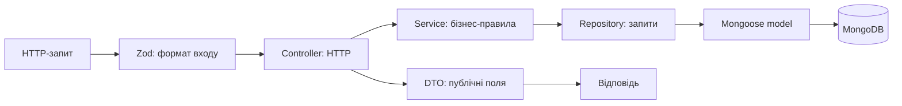

# Стартовий backend: основа спільної розробки

**Презентація команді · 12 жовтня 2026 року · каркас 0.3.0**

Документ для знайомства команди з проєктом. Розрахований на презентацію 15–20 хвилин. Опис відповідає поточному коду; майбутні можливості позначено окремо.

## 1. Мета та поточний результат

Маємо невеликий робочий backend приватного дитячого садка. На модулі groups показано повний шлях: HTTP-запит → перевірка → бізнес-операція → MongoDB → відповідь. На цій основі поступово розроблятимемо дітей, представників, персонал, довідники, розклад, рахунки, платежі та фінансові звіти.

| Уже працює | Наступні можливості |
|---|---|
| Створення DRAFT-групи, список і читання за ID | Активація груп, зарахування та інші модулі |
| MongoDB, збереження записів після перезапуску API | Пагінація, подальші індекси та транзакційні сценарії |
| Aggregation-звіт груп за віком | Фінансові aggregation-звіти |
| Повторюваний seed із 8 вигаданими групами | Демодані інших реалізованих модулів |
| HTTP-захист, валідація, DTO, Swagger | JWT, ролі, політики доступу й аудит |
| Debugger PhpStorm, HTTP tracing та /health/ready | Пагінація груп |

/health/ready використовує isMongoReady через DI та перевіряє ping MongoDB. /health/live підтверджує роботу процесу незалежно від доступності бази.

## 2. Стек

| Інструмент | Призначення |
|---|---|
| JavaScript ESM, Node.js | Серверний код та import/export; команда використовує Node.js 24, мінімум 22 |
| Express | HTTP-маршрути й middleware |
| MongoDB, Mongoose | Зберігання та моделі документів |
| MongoDB Aggregation Framework | Групування та обчислення звітів у базі |
| Zod | Перевірка вхідних запитів |
| Helmet, express-rate-limit | Базовий HTTP-захист |
| OpenAPI, Swagger UI | Контракт API та перевірка запитів |
| OpenTelemetry, Jaeger | Локальний HTTP tracing |
| node:test, Prettier | Автоматичні перевірки та стиль коду |

Node.js запускається на комп’ютері; MongoDB і Jaeger — у Docker через один compose.yaml. Кожен студент має власну локальну базу. TypeScript, Redis та RabbitMQ до поточного стеку не входять.

## 3. Архітектурний підхід і причини вибору

**Модульний моноліт із простою шаровою організацією всередині плоских модулів.** Один застосунок та API, код поділено за бізнес-функціями. Усередині модуля кожен файл має зрозумілу відповідальність.

Підхід обрано для команди, яка вивчає Node.js:

- Шлях запиту можна простежити в кількох файлах.
- Різні учасники працюють над модулями за однаковими домовленостями.
- Один service містить методи модуля; окремий клас для кожної операції не потрібний.
- Repository відокремлює бізнес-код від Mongoose та aggregation-запитів.
- Ручний DI дозволяє підставляти тестові залежності без додаткової бібліотеки.
- Плоскі папки зменшують кількість переходів між файлами.

Правильність фінансів, місткості та доступу забезпечуватиметься перевірками, індексами й потрібними транзакціями. Простота папок не скасовує цих бізнес-вимог.



## 4. Де писати код

```text
src/
├── server.js          підключення БД, запуск HTTP, завершення
├── app.js             Express, спільні middleware, готовий API-router
├── config/            перевірка налаштувань і підключення
├── middleware/        захист, валідація, помилки, журнал, tracing
├── telemetry/         технічна конфігурація OpenTelemetry
├── openapi/           складання документації зі схем Zod
├── utils/             спільні помилки та HTTP-утиліти
└── modules/
    ├── index.js       реєстрація модулів та складання repositories
    └── groups/
        ├── group.routes.js
        ├── group.controller.js
        ├── group.service.js
        ├── group.repository.js
        ├── group.model.js
        ├── group.schema.js
        ├── group.openapi.js
        ├── group.dto.js
        ├── group.constants.js
        └── group.module.js
```

| Файл | Відповідальність |
|---|---|
| routes | URL, HTTP-метод, порядок перевірок і метод контролера |
| controller | Перевірений вхід, виклик service, HTTP-статус і DTO |
| service | Бізнес-правила, послідовність дій, надалі — перевірки прав |
| repository | MongoDB-запити, aggregation, перетворення _id на строковий id |
| model | Mongoose-схема документа та перевірки при записі |
| schema | Zod-контракти входу та публічної відповіді |
| openapi | Опис операцій для Swagger із використанням готових схем |
| dto | Явний перелік публічних полів відповіді |
| constants | Стани, обмеження та коди помилок |
| module | Створення service/controller і складання DI |

Controller не виконує запити до БД. Service не використовує Express або Mongoose. Repository повертає звичайні об’єкти; Mongoose-документи й ObjectId залишаються всередині нього.

app.js не імпортує модель груп або їхній repository. Нові бізнес-модулі реєструємо в modules/index.js; готовий router передаємо в createApp.

Swagger генерується із Zod та описів операцій; документацію нового модуля реєструємо в openapi/document.js. JSON у docs — лише експорт. Практична інструкція — [11_OpenAPI_Generation.md](../development/11_OpenAPI_Generation.md).

## 5. Класи та DI

DI — Dependency Injection, передавання залежностей ззовні. Service, repository, controller та module реалізовані класами; залежності передаємо через конструктори.

```javascript
export class GroupModule {
  constructor({ groupRepository }) {
    const groupService = new GroupService({ groupRepository });
    const groupController = new GroupController({ groupService });
    this.router = createGroupRoutes({ groupController });
  }
}
```

Repository отримує модель, service — repository, controller — service. У тесті передаємо сховище в пам’яті замість MongoDB-репозиторію. Звичайний запуск не переходить на пам’ять при помилці бази.

Методи контролера використовують this, тому прив’язуємо callback Express:

```javascript
router.get('/', groupController.list.bind(groupController));
```

DTO, чисті перевірки, складання router і технічні helpers можуть бути функціями. Клас потрібний для об’єкта із залежностями й пов’язаними методами. Спадкування та універсальні базові класи вводимо тільки за реальною потребою.

## 6. Валідація та DTO

| Рівень | Що перевіряє або визначає |
|---|---|
| Zod | Типи, обов’язкові та невідомі поля HTTP-запиту |
| Service | Бізнес-правила незалежно від HTTP: наприклад, місткість 1–20 і статус DRAFT |
| Mongoose | Структуру документа при записі через модель |
| DTO | Дозволені поля відповіді: id, name, ageCategory, capacity, status |

DTO — Data Transfer Object, об’єкт передачі даних. Будуємо його явно, не відправляємо клієнту весь MongoDB-документ. Для майбутніх персональних даних політика визначатиме також доступні поля.

Mongoose не перевіряє ручні записи з PhpStorm або mongosh. Seed перевіряє приклади через service-функцію buildGroupDraft.

## 7. Стиль коду та константи

- Документація й коментарі українською; технічні назви англійською.
- Класи: GroupService, GroupRepository. Методи та змінні: createGroup, groupRepository.
- Короткі методи, зрозумілі назви й одна відповідальність на метод.
- Коментар пояснює причину або нетривіальне правило.
- Бізнес-помилки мають стабільний code та обробляються централізовано.
- Тимчасові console.log прибираємо; журнал HTTP уже підключений централізовано.

| Константи | Де лежать |
|---|---|
| GROUP_STATUS, GROUP_LIMITS, GROUP_ERROR_CODES | group.constants.js |
| HTTP_STATUS, загальні HTTP_ERROR_CODES | utils/httpConstants.js |
| Початкові ліміти та тайм-аути | config/securityDefaults.js |

Пишемо GROUP_STATUS.DRAFT і HTTP_STATUS.CREATED. Zod, service та model беруть обмеження з одного джерела. Повторювані значення виносимо в константи; зрозумілі одноразові технічні значення можуть залишатися локально. Об’єкти констант заморожені через Object.freeze.

Prettier: два пробіли, одинарні лапки, крапки з комою, ширина рядка 100. Це dev-залежність, без викликів під час роботи API. Перед передачею змін:

```bash
npm run format
npm run check
```

## 8. Безпека

```text
requestId і журнал → HTTP tracing → Helmet → загальний rate limit
→ ліміт запису → JSON-парсер → маршрути та Zod → errorHandler
```

Rate limit стоїть перед парсером: відхилене тіло не потрібно розбирати.

| Уже реалізовано | Початкове налаштування |
|---|---|
| Helmet | Захисні HTTP-заголовки з урахуванням локального HTTP |
| Загальний rate limit | 300 запитів за 60 секунд з IP, включно з health і невідомими маршрутами |
| Ліміт запису під /api/v1 | 30 POST/PUT/PATCH/DELETE за 60 секунд з IP |
| Ліміт JSON | 32 КіБ |
| Отримання заголовків / запиту | 10 / 30 секунд |
| Бездіяльність сокета / keep-alive | 30 / 5 секунд |
| Завершення процесу | До 5 секунд |
| trust proxy=false | Підроблений X-Forwarded-For не визначає клієнтський IP |
| Помилки API | code, повідомлення, requestId; без stack у відповіді |
| Валідація та DTO | Відхилення невідомих полів, явний набір публічних полів |
| Локальна інфраструктура | MongoDB, Jaeger та Inspector доступні через loopback |

Параметри захисту змінюються через .env й перевіряються при запуску. Rate limit має лічильники в пам’яті процесу для поточного локального запуску.

**JWT, ролі, права на записи та аудит ще не реалізовані.** Поточні маршрути публічні для локальної навчальної роботи. Використовуємо вигадані дані; каркас ще не призначений для реальних даних дітей.

Майбутній middleware перевірятиме токен, service — право на дію та запис, DTO — доступні поля. Для фінансів і зарахування реалізуємо потрібні індекси, транзакції та аудит за вимогами.

.env не входить до Git; .env.example — приклад для команди. Паролі й токени не записуємо в коміти або демодані.

## 9. Запуск на macOS та Windows

Потрібні Node.js 24 і запущений Docker Desktop. Windows використовує WSL 2 та Linux containers. Команди виконуємо з кореня проєкту.

### macOS

```bash
npm ci
cp -n .env.example .env
npm run infra:up
npm run seed
PORT=3100 npm run dev
```

### Windows — PowerShell

```powershell
npm.cmd ci
if (!(Test-Path .env)) { Copy-Item .env.example .env }
npm.cmd run infra:up
npm.cmd run seed
$env:PORT = '3100'
npm.cmd run dev
```

Існуючий .env зберігаємо. За замовчуванням API використовує 3000; для презентації приклади використовують 3100. npm.cmd обходить залежність від дозволу виконувати npm.ps1.

Seed запускає MongoDB, ініціалізує rs0 та додає 8 груп: по дві для віку 2–5 років. Усі DRAFT. Повтор додає тільки відсутні записи й зберігає ручні зміни; ID не залежить від порядку прикладів.

| Перегляд | Адреса |
|---|---|
| Swagger | http://127.0.0.1:3100/api-docs/ |
| Інформація API | http://127.0.0.1:3100/api/v1 |
| Aggregation-звіт | http://127.0.0.1:3100/api/v1/groups/summary |
| Jaeger | http://127.0.0.1:16686 |

API зупиняємо Ctrl+C; контейнери — npm run infra:down (Windows: npm.cmd run infra:down). Дані MongoDB залишаються у volume, трейси Jaeger після зупинки втрачаються.

Повна інструкція та типові помилки — [06_Local_Startup.md](../development/06_Local_Startup.md).

## 10. Перегляд бази, debug та tracing

PhpStorm Database: Data Source → MongoDB, без авторизації, URL:

```text
mongodb://127.0.0.1:27017/kindergarten_dev?replicaSet=rs0&directConnection=true
```

API та PhpStorm читають одну groups. Новий запис зі Swagger видно після оновлення колекції.

Для debugger зупиняємо dev і запускаємо на macOS:

```bash
PORT=3100 npm run debug
```

У PowerShell: $env:PORT = '3100', потім npm.cmd run debug. У PhpStorm — Attach to Node.js/Chrome, Host 127.0.0.1, Port 9229, кнопка Debug. HTTP-запити йдуть на 3100. Після зміни коду debug-процес перезапускаємо.

Tracing працює централізовано: один HTTP-span на запит. Бізнес-модулі не підтримують tracing-файли. Видно тривалість, статус, код помилки й Trace ID; у dev — JSON запиту/відповіді. Окремих кроків service/repository немає.

Dev-показ потребує NODE_ENV=development та TELEMETRY_DEBUG_DATA=true; production/test вимикають дані. Відомі секретні поля маскуються за назвою, JSON обмежений за обсягом. Фільтр не розпізнає секрет, випадково вписаний у довільний текст. Використовуємо вигадані записи. [Інструкція tracing](../development/05_Local_Telemetry.md).

## 11. Перевірки та командна робота

| Команда | Коли виконувати |
|---|---|
| npm run format | Після змін для єдиного стилю |
| npm run check | Перед передачею: формат, синтаксис, регресійні тести |
| npm run test:mongodb | Після змін repository/model/aggregation; потрібна MongoDB |

У PowerShell — npm.cmd. MongoDB integration-тест використовує власну випадкову базу й видаляє тільки її. У звичайному check його пропущено, щоб перевірка працювала без Docker.

Каркас уже перевірявся на 16 регресійних тестах та окремому MongoDB-тесті: CRUD, aggregation, перезапуск зі збереженням запису, Swagger у Chrome, HTTP tracing і завершення при помилках запуску. Для нових змін перевірки виконуємо знову. Фізичний Windows-запуск у цій сесії не проводився.

Робочий цикл:

1. Вибрати одну невелику операцію з узгоджених вимог.
2. Визначити вхід, вихід, правила й очікувані помилки.
3. Розкласти відповідальність між schema, service, repository, controller і DTO.
4. Написати код, перевірити через Swagger та debugger.
5. Додати потрібні перевірки успіху й відмови.
6. Оновити OpenAPI і документацію, виконати check.
7. Передати невелику зміну іншому учаснику на review.

Спільні modules/index.js, middleware, config та OpenAPI змінюємо узгоджено. Git-репозиторій і CI ще потрібно організувати перед регулярною інтеграцією; поточна локальна папка не містить .git.

## 12. Сценарій презентації

| Час | Що показати |
|---|---|
| 0–3 хв | Мету каркаса, готові можливості та межі |
| 3–7 хв | Папку groups, шлях запиту та GroupModule із DI |
| 7–11 хв | Swagger: список → створення → читання → summary |
| 11–14 хв | Той самий запис у Database; breakpoint controller/service |
| 14–17 хв | Невалідну місткість, DTO, захист і HTTP trace |
| 17–20 хв | Запуск, стиль, перевірки й наступну задачу |

Для POST /api/v1/groups:

```json
{
  "name": "Командна демогрупа",
  "ageCategory": 4,
  "capacity": 20
}
```

Очікуємо 201, DRAFT та строковий id. Повторіть із capacity=21: очікуємо 400 і VALIDATION_ERROR. Summary показує кількість груп і місткість, а не кількість зарахованих дітей. Після створення групи записів буде більше за початкові 8 — це очікувано.

## 13. Наступний крок та матеріали

/health/ready реалізовано: MongoDB через DI, відповіді 200/503, тести й OpenAPI. Наступний крок — пагінація та решта критеріїв зберігання. Нові бізнес-модулі додаємо послідовними завершеними сценаріями.

- [Бізнес-вимоги](../requirements/00_Consolidated_Requirements.md).
- [Архітектура та відповідальності](../architecture/02_Architecture_Decisions.md).
- [Майбутні політики доступу](../architecture/03_Access_Control.md).
- [Карта сутностей](../architecture/04_Entity_Diagrams.md).
- [Запуск Windows/macOS](../development/06_Local_Startup.md).
- [Шпаргалка команд](../development/07_Commands_Cheatsheet.md).
- [План і стан реалізації](../planning/plans/Implementation_Plan.md).

